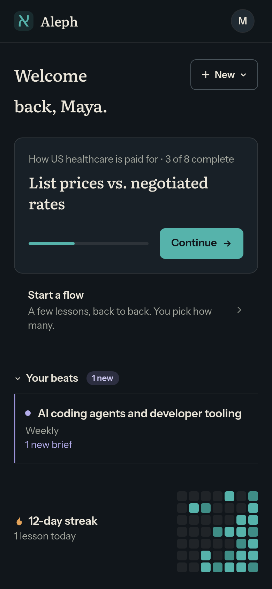
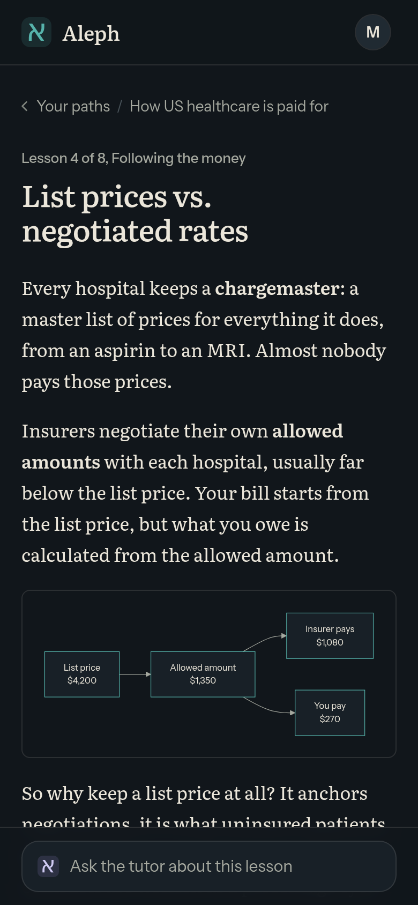
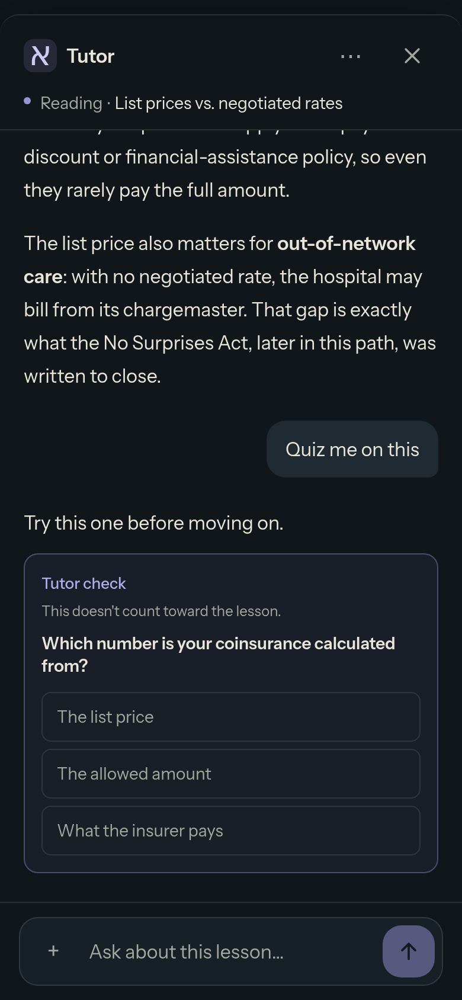
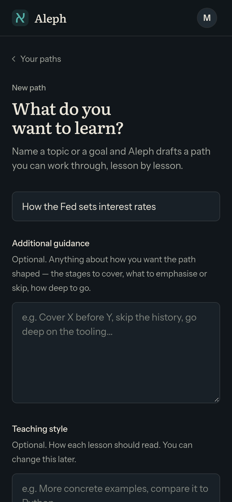
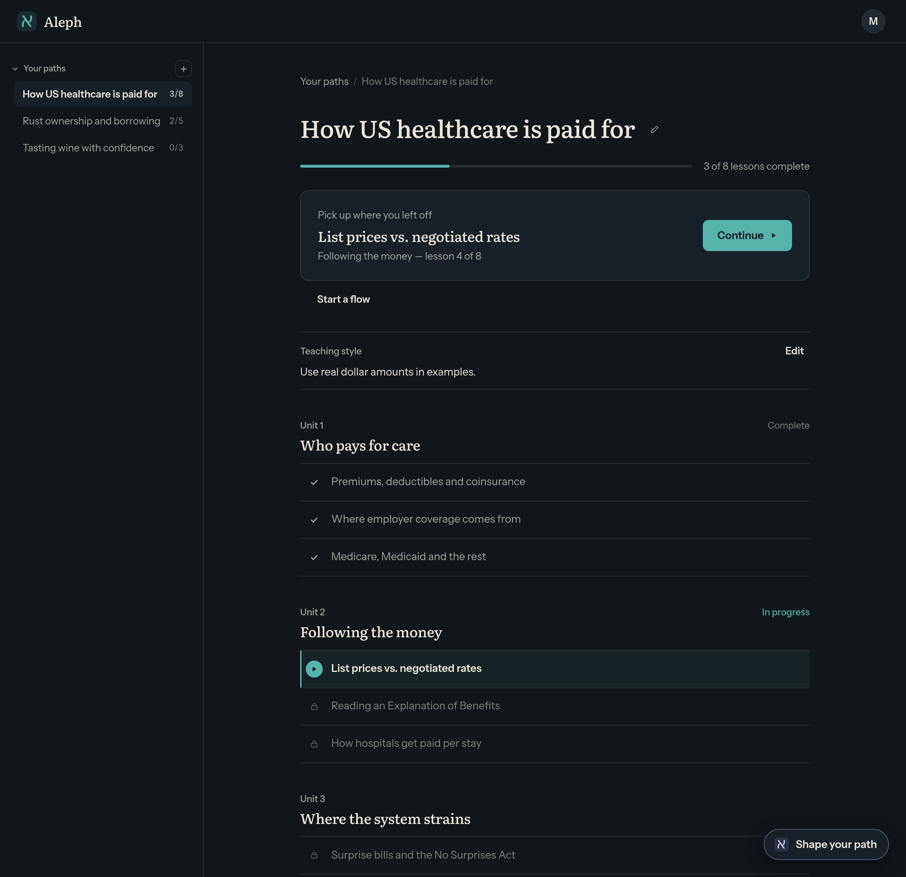
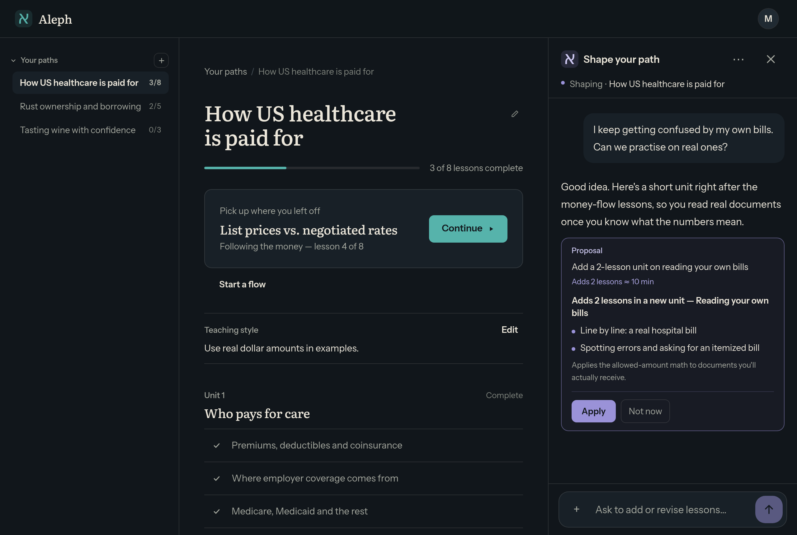
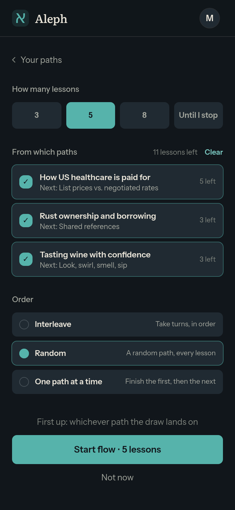
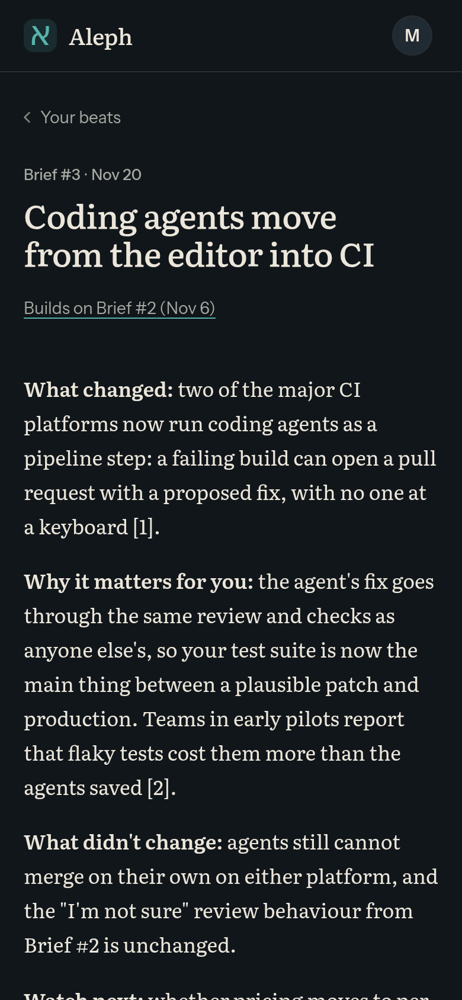
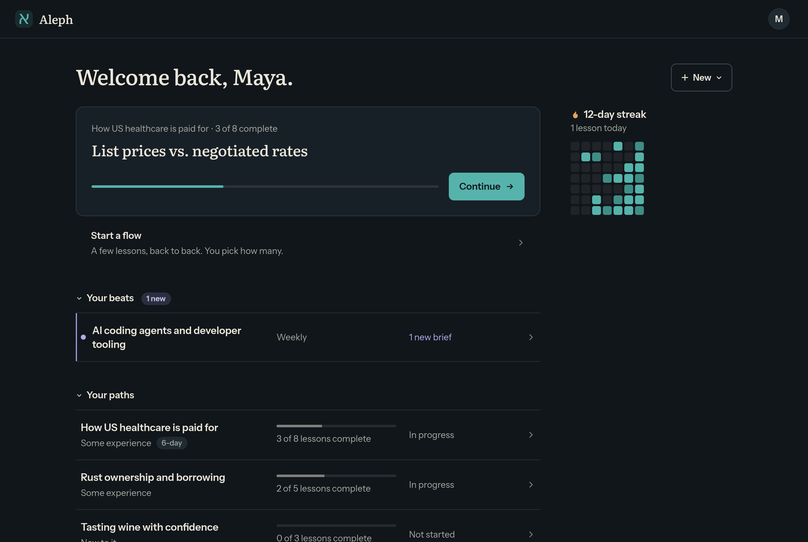

# aleph

**Learn anything in ten-minute lessons, on your phone.** Name a topic, and Aleph
builds you a personal learning path: short lessons, each with a check that you
got it, and a tutor that knows exactly which lesson you're on. When the path
isn't quite right, ask, and Aleph reshapes it.

**[Try it at aleph.mattjmcnaughton.com →](https://aleph.mattjmcnaughton.com)**

<p>
  
  
  
</p>

## Why Aleph

Most ways to learn a new subject make you choose: courses are thorough but rigid
and written for someone else, and chatbots are flexible but forget where you
are and never build on yesterday. Aleph is both.

- **A real path, not a chat log.** Your topic and level become units and
  lessons that build on each other, so lesson 7 never re-teaches lesson 3.
- **Bite-sized and phone-first.** Each lesson is one short Read passage and one
  Quick check. Pick up where you left off from anywhere.
- **A tutor that knows where you are.** Ask "why?" mid-lesson and get an answer
  grounded in the lesson you're reading, not a generic one.
- **A path that bends around you.** Tell Aleph what's missing. It proposes the
  change, shows it in place, and changes nothing until you tap Apply.
- **Momentum without the gimmicks.** A daily streak, a run of lessons
  back to back with Flow, and nothing else.
- **Stay current, too.** Deploy a Beat on a fast-moving subject and get a weekly,
  cited Brief on what changed since the last one.

It works for any subject: how US healthcare is paid for, Rust ownership,
clinical trial monitoring, or tasting wine.

## Get started

1. Open **[aleph.mattjmcnaughton.com](https://aleph.mattjmcnaughton.com)** on your
   phone or computer.
2. Tap **Continue**, then **Sign up** with email or **Continue with Google**.
3. Tap **New path**, type what you want to learn, pick how much you already
   know, and tap **Build my path**. Your first lesson is ready as soon as the
   outline is.

On iPhone, use **Share → Add to Home Screen** to open Aleph like an app.

## A closer look

### Name a topic, get a path

Say what you want to learn and how much you already know. Optionally, steer what
the path covers, how lessons should read, and whether to search the web first.



### Work through it lesson by lesson

Units and lessons unlock in order, and you can always see where you are.



### Shape your path

Ask for what's missing. The tutor answers with a Proposal you can read before
anything changes; Apply adds the lessons, and Undo takes them back.



### Flow, Beats and Briefs

Start a Flow to take several lessons back to back across your paths. Deploy a
Beat to follow a subject that is still moving: each weekly Brief says what
changed, builds on the last one, and cites its sources.

<p>
  
  
</p>



*Screenshots show the real app over demo data. Recapture them with
`just screenshots` (see [Screenshots](#screenshots)).*

## Status

Live in production at [aleph.mattjmcnaughton.com](https://aleph.mattjmcnaughton.com)
and deployed continuously from `main`. Generated paths, the tutor, shaping,
streaks and the analyst (Beats and Briefs) are all launched. See
[docs/roadmap.md](docs/roadmap.md) for what's shipped and what's next.

## Development

Python (FastAPI, SQLAlchemy, pydantic-ai) serves the API, and a React app in
[`src/aleph/web/frontend/`](src/aleph/web/frontend/) is the one client, on the
web and the Home Screen. Read [CONSTITUTION.md](CONSTITUTION.md) and
[docs/CONTEXT.md](docs/CONTEXT.md) (the project's vocabulary) before contributing.

### Prerequisites

- Python 3.12+ and [uv](https://docs.astral.sh/uv/)
- [just](https://just.systems/)
- [Docker](https://www.docker.com/) (Postgres and Keycloak for local sign-in)
- [Node.js](https://nodejs.org/) 20+ and [pnpm](https://pnpm.io/)

### Run it locally

```sh
uv sync --dev
cp .env.example .env
(cd src/aleph/web/frontend && pnpm install)

just compose-db-up            # Postgres
just compose-keycloak-up      # Keycloak, for local sign-in
uv run alembic upgrade head   # migrations

just dev                      # backend on :8000 and the frontend dev server
```

Real generation needs `OPENROUTER_API_KEY` in `.env`; without it, point the
`MODEL_*` slots at `stub` for deterministic offline content. See
[docs/development.md](docs/development.md) for the full setup and debugging.

### Checks

| Command | What it runs |
| ------- | ------------ |
| `just gate` | Format, lint, typecheck and unit tests (backend + frontend). Run before pushing. |
| `just test-integration` | Integration tests against real Postgres and Keycloak |
| `just test-e2e` | Playwright journeys on a phone viewport |
| `just gate-expensive` | All of the above |
| `just evals` | The generation eval harness (costs money; see [docs/evals.md](docs/evals.md)) |

Every check has `-be` and `-fe` variants, such as `just lint-fe`.

### Screenshots

`just screenshots` recaptures every image in
[`docs/screenshots/readme/`](docs/screenshots/readme/). It renders the real
frontend with API calls answered by the app's own test fakes, seeded with the
demo account in
[`tests/screenshots/demo-data.ts`](src/aleph/web/frontend/tests/screenshots/demo-data.ts),
so it needs no backend, account or model. Rerun it after a visible UI change.

### Deploying

Merging to `main` releases and deploys automatically: semantic-release reads
[Conventional Commits](https://www.conventionalcommits.org/), and a `fix:` or
`feat:` commit ships to Fly.io. See [docs/deploy.md](docs/deploy.md).

### Docs

- [docs/architecture.md](docs/architecture.md): structure and layering
- [docs/api.md](docs/api.md): API reference
- [docs/roadmap.md](docs/roadmap.md): phases and their specs
- [docs/deploy.md](docs/deploy.md): production runbook and secrets

## License

[MIT](LICENSE)
