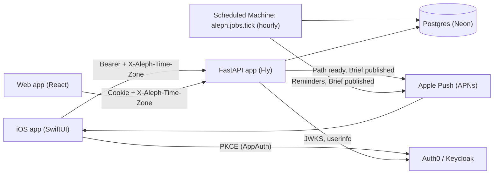

# TDD — The iOS app (native SwiftUI client)

> **Parked (conditional), 2026-10-20.** Follow the accepted
> [Home Screen app execution amendment](home-screen-app.md#execution-amendment-2026-10-20),
> not this native build plan. T0 is deferred to the end, not passed; native remains
> the fallback if feasibility fails. Instructions below (including Swift parity,
> CI and shipping) are historical, not requirements for active Home Screen work.
> No native implementation or native backlog edits are authorized by this adoption.

**Status:** plan, ready to build · **Owner:** solo builder · **Companion to:** [iOS app PRD](../prds/ios-app.md)
**References:** [`CLAUDE.md` — Two Clients](../../CLAUDE.md#two-clients-web-and-ios) · [`CONTEXT.md`](../CONTEXT.md) · [`api.md`](../api.md) · [`architecture.md`](../architecture.md) · [`ci.md`](../ci.md) · [`deploy.md`](../deploy.md) · [ADR 0001 — store the last-seen time zone](../adrs/0001-store-last-seen-time-zone.md) · [ADR 0002 — iOS-owned Markdown renderer](../adrs/0002-ios-owned-markdown-renderer.md) · [Flow TDD](flow.md) · [Phase 2 TDD](phase-2-tutor.md) · [Phase 6 TDD](phase-6-analyst.md)
**Builds on:** the home-screen PoC on [`claude/ios-homescreen-poc`](https://github.com/mattjmcnaughton/aleph/tree/claude/ios-homescreen-poc) (kept as a reference branch, not merged; its CI runs: [record](https://github.com/mattjmcnaughton/aleph/actions/runs/39064335563), [compare](https://github.com/mattjmcnaughton/aleph/actions/runs/39065171978)) (`clients/ios/`, `.github/workflows/ios.yml`)

> **This document is the implementer's brief.** It is written for an engineer (or agent) starting
> cold. Where it says **settled**, the owner decided; do not re-open it. Where it says **decided
> here**, the author chose and the owner can overturn it in review. Where this TDD and the PRD
> disagree, this TDD wins, and the PRD carries a pointer to it. Codebase facts are cited against
> `main` at `6e68bf3` (after PR #218 and #219).
>
> Decision numbers below restart at D1 and are scoped to this document. PRD decisions are always
> qualified ("PRD D7").

## 0. Brief for the implementer

**What you are building.** A native iPhone app (SwiftUI, iOS 26+) that is a second client of the
same `/api/v1` the React app uses, at **full feature parity** with the web: paths, lessons, Quick
checks, the tutor and shaping streams, streaks, Beats and Briefs, and Flow. It adds one thing only
a phone can do — **push notifications** — and the backend gains what push needs: a stored
**Learner time zone**, device registration, an APNs sender, and an **hourly scheduled job**.

**What is already done.** Bearer auth on every `/api/v1` route (PR #218, `src/aleph/bearer.py`,
`src/aleph/dependencies.py`). A PoC (`claude/ios-homescreen-poc`) that proves the loop *push
Swift → macOS CI builds → snapshot PNGs come back to the branch*.

**What you should read first, in this order.**

1. [`CLAUDE.md`](../../CLAUDE.md) — commands, layering, the **Two Clients** rules, commit rules.
2. [`docs/CONTEXT.md`](../CONTEXT.md) — the vocabulary is authoritative, and it applies to Swift
   type names and UI copy. Say **path**, **Quick check**, **Read passage**, **Mark complete**,
   **Beat**, **Brief**, **Learner time zone**, **Reminder**, **Notification**, **Device**.
3. §1 of this document if you are new to iOS. It is skimmable in about fifteen minutes.
4. The PRD's §5 for the screen you are building, then the ticket in §18 here.
5. The web file the ticket names. Every client-side rule is **written twice and tested twice**;
   the web file is the reference implementation.

**How to work.** Red-green TDD, fakes over mocks (protocol-backed in-memory fakes in Swift,
exactly as in Python). One commit per ticket where possible, Conventional Commits. After ticket 3
lands, iOS-only commits use the **`(ios)` scope** (`feat(ios): …`), which semantic-release
ignores; a commit that also touches the backend must **not** use `(ios)`. If you cannot run Xcode
(a Linux container), push to an `ios-dev/<topic>` branch and read the PNGs CI commits back
(§17.3). You **can** run `swift test` on Linux for `Core`, `Markdown` and `API` once the Swift
toolchain is available (this sandbox blocks `download.swift.org`, so a local Linux toolchain needs
that host allowed; CI uses the `swift:6.2` container image instead).

**Settled vs decided here, at a glance.** Settled: scope (full parity; admin tools web-only; push
iOS-only), iOS 26 floor, dark only, Xcode 26.x on `macos-26`, `clients/ios/` + `clients/web/`, the
TS client, screen models with state enums, the six local packages and their isolation, the
committed OpenAPI document and generated Swift client, Linux `swift test`, swift-markdown with an
allowlist renderer, AppAuth behind `AuthSession`, the stored Learner time zone, the three push
kinds and their permission UX, the hourly job and its schedules file, the `client` event
dimension, the SSE spike, polling rules, online-only, Flow behind its flag with its default
flipped on, Beat delete on both clients, the testing stack, the CI shape, TestFlight cadence and
the `(ios)` release scope. Signing is **deferred** (§20). Everything marked *decided here* in §2
is the author's call.

## 1. iOS best practices for a newcomer

Written for an engineer fluent in backend and web work who is new to iOS. Each topic says
**what it is**, the **web analogy** (and where it breaks), and **what aleph does**. Tags: **[V]**
checked against a linked source, **[J]** long-standing practice or judgment, not re-verified.
The design sections cite these topics as §1.Ax / §1.Bx.

**The 2026 landscape.** It is October 2026: iOS 26 is one release old, Xcode 27 (Swift 6.4, iOS 27
SDK) shipped in September, and GitHub's `macos-26` image is GA with **Xcode 26.6** as its default
(26.0.1–26.6 installed side by side, iOS simulators up to 26.5 with *iPhone 17*), while Xcode 27 is
a **preview** image (`xcode-27`)
[V: [runner-images README](https://github.com/actions/runner-images),
[macos-26-arm64 image readme](https://github.com/actions/runner-images/blob/main/images/macos/macos-26-arm64-Readme.md),
[Xcode 27 notes](https://developer.apple.com/documentation/xcode-release-notes/xcode-27-release-notes)].
App Store Connect requires the iOS 26 SDK or later for uploads
[V: [Apple upcoming requirements](https://developer.apple.com/news/upcoming-requirements/)].
Three consequences: the **deployment target** (iOS 26) and the **SDK** you build with are separate
settings; with an iOS 26 floor every device shows **Liquid Glass**, and the opt-out key is ignored
from the iOS 27 SDK on, so design for it; the SwiftUI `App` lifecycle is already scene-based, which
the iOS 27 SDK makes mandatory [V: [DTS answer](https://developer.apple.com/forums/thread/832543)].

### 1.A The code

**A1. Toolchain and language mode.** *What:* Xcode is compiler, SDK, simulator and signing tool in
one bundle; the Swift version comes with it. *Web analogy:* pinning `node:22` in CI, except an Xcode
bump also changes simulator rendering, so every snapshot PNG can move. *aleph:* Swift 6 language
mode with complete concurrency checking from the first commit (the PoC's `SWIFT_VERSION: "5.0"` is
raised to 6); Xcode **26.6** pinned by path on `macos-26` (settled), never `latest-stable`; move to
Xcode 27 when GitHub's image leaves preview. Avoid Swift 6.4-only syntax until then.

**A2. Swift 6 concurrency and actor isolation.** *What:* the compiler proves code free of data
races. An **actor** serialises access to its own state; `@MainActor` means "runs on the UI thread";
`Sendable` means "safe to hand to another thread"; **structured concurrency** (`async let`, task
groups, SwiftUI's `.task`) ties a child task's lifetime to its parent. Since Swift 6.2 a module can
**default** everything to `@MainActor` (SE-0466), `nonisolated async` functions run on the caller's
actor, and `@concurrent` opts into the background
[V: [Donny Wals](https://www.donnywals.com/setting-default-actor-isolation-in-xcode-26/),
[useyourloaf](https://useyourloaf.com/blog/approachable-concurrency-in-swift-packages/)].
*Web analogy:* JavaScript has one thread, so there is no such bug class; Python's asyncio is the
nearest relative, but here the type checker enforces isolation. Cancellation is **cooperative**,
like `AbortSignal`: a cancelled task runs until it hits `Task.sleep`, an `await` on URLSession, or
`Task.checkCancellation()`. *aleph (settled):* `App`, `Features`, `Design` default to MainActor;
`Core`, `API`, `Auth`, `Markdown` stay nonisolated and expose `Sendable` structs and enums (frozen
dataclasses). Token refresh is an `actor` holding one in-flight `Task` (single-flight, §5.3). No
`Task.detached`, `DispatchQueue` or `@unchecked Sendable` without a one-line justification
(AppAuth's Objective-C types are the expected exception).

**A3. Screen state: `@Observable` screen models.** *What:* `@Observable` (the Observation framework)
makes a class's properties trackable; a view re-renders only when a property it actually *read*
changes. *Web analogy:* a small per-screen store (Zustand-ish), with fine-grained updates like
signals in Solid — not React's re-render-the-subtree. *aleph (settled):* plain SwiftUI views plus
**one `@Observable` model per screen** that exposes an **exhaustive state enum** mirroring the API
states, so impossible states cannot be represented. No TCA (a large dependency and a second thing
to learn) and no logic in views (untestable without UI tests). §6 has the worked example.

**A4. Dependency injection without a framework.** *What:* pass collaborators in. *Web analogy:*
FastAPI's `Depends`; SwiftUI's `@Environment` is React context. *aleph:* one `AppDependencies`
struct of protocol-typed services, built **once** in the `App`, published through `@Environment`;
screen models receive what they need **through their initialiser** and never read the environment,
so they test without SwiftUI. No singletons, no service locator (§3.4).

**A5. Navigation and deep links.** *What:* `NavigationStack(path:)` is a push/pop stack driven by
an array of values; `.navigationDestination(for:)` maps a value to a screen. *Web analogy:* a router
whose history is an array **you own** — push is `append`, back is `removeLast`. There is no URL bar,
so a deep link is "replace the array"; back is a system edge-swipe you never fight. *aleph:* one
`Router` holding `[Route]` (`Route` is a `Hashable, Codable` enum of ids); push payloads carry
**typed ids, never URLs**; the `aleph://` scheme is reserved for the OAuth callback so an untrusted
Markdown link can never drive navigation (§3.5).

**A6. Local Swift packages.** *What:* SwiftPM packages inside the repo; the app target is a thin
shell. *Web analogy:* a pnpm/uv workspace, but the payoff is **enforced boundaries** (`internal` is
the default access level; a package can only import what its manifest lists) and incremental
build/test speed. *aleph (settled):* `Core`, `API`, `Auth`, `Markdown`, `Design`, `Features` plus a
thin `App` target; the manifests are the layering test (`Features` cannot import AppAuth or the
generated client) (§3.3).

**A7. Networking and SSE.** *What:* `URLSession` is the built-in HTTP client; `data(for:)` returns a
body, `bytes(for:)` an async byte stream. swift-openapi-generator turns `openapi.json` into a typed
client whose **middleware** is a fetch interceptor. swift-openapi-runtime ships a spec-compliant SSE
decoder, `asDecodedServerSentEvents()`, over any async byte sequence
[V: [source](https://github.com/apple/swift-openapi-runtime/blob/main/Sources/OpenAPIRuntime/EventStreams/ServerSentEventsDecoding.swift),
[SOAR-0010](https://forums.swift.org/t/proposal-soar-0010-support-for-json-lines-json-sequence-and-server-sent-events/69098)].
*Web analogy:* `data(for:)` is `fetch().json()`, `bytes(for:)` is `fetch().body.getReader()` —
exactly what api.md tells web clients to use instead of `EventSource`. *Pitfall [J]:* if you parse
SSE by hand, **do not use `bytes.lines`** — the line iterator skips empty lines, and in SSE a blank
line *is* the event delimiter. *aleph:* JSON routes through the generated client behind app-owned
protocols; the two stream routes behind `TutorStream`/`ShapingStream` (§8). `tz_offset_minutes` is
`-secondsFromGMT / 60` — **the opposite sign** of Foundation's convention, unit-tested.

**A8. Errors.** *What:* Swift errors are values you `throw`; `try` is written at every call site.
*Web analogy:* closer to Python exceptions than to promises, but visible. *aleph:* one `AppError`
enum mapped in the API adapter from the shared envelope's `code`, `URLError` and auth failures;
screens never see `URLError` or generated types; every state enum has explicit failed cases with
copy and a retry (§4.4).

**A9. Logging.** *What:* `os.Logger` is Apple's structured, near-free logger; interpolated values are
**redacted by default** in release builds unless marked `privacy: .public`. *Web analogy:* structlog,
but logs stay **on the device** — there is no log drain. *aleph:* one logger per category (`api`,
`auth`, `stream`, `poll`, `push`); ids and status codes `.public`; tokens, Read passages, Quick check
payloads and tutor text are never logged. No OpenTelemetry in the app in v1 (settled)
[V: [OTel Swift status](https://opentelemetry.io/docs/languages/swift/libraries/)].

**A10. Formatting and linting.** *What:* `swift format` (Apple's swift-format) ships in the
toolchain; SwiftLint is a separate community tool, and Nick Lockwood's *SwiftFormat* is a different
project with a confusing name [V: [M. Tsai](https://mjtsai.com/blog/2024/11/06/swift-format-in-xcode-16)].
*Web analogy:* ruff format + ruff check. *aleph (settled):* `swift format` only, with a committed
`.swift-format`, run in CI with `--strict`; it runs on Linux too. The compiler's strict concurrency
and `-warnings-as-errors` (CI only) do most of what a linter would.

**A11. Dependencies.** *What:* SwiftPM resolves git URLs + tags into a committed `Package.resolved`
(the lockfile); there is no registry, so a re-tagged release could change underneath you. Build
plugins and macros run code at build time and need trust flags in CI. *aleph (settled):* SPM only,
**exact** pins, minimal set — AppAuth-iOS, swift-markdown, swift-openapi-runtime and
-urlsession, and swift-snapshot-testing (test-only). The generator runs as a script, not a build
plugin (§4.2), so CI needs no plugin trust. Each new dependency gets a justification line here.

**A12. Testing layers.** *What:* **Swift Testing** (`@Test`, `#expect`) is the modern unit framework
and runs on Linux; **XCTest** remains the only home of UI automation (XCUITest)
[V: [WWDC26 session 267](https://developer.apple.com/videos/play/wwdc2026/267)]; swift-snapshot-testing
renders a view to PNG and compares it with a committed reference
[V: [README](https://github.com/pointfreeco/swift-snapshot-testing)]. *Web analogy:* Vitest unit
tests, Playwright journeys, and Playwright screenshot assertions respectively. *aleph (settled):*
Swift Testing for unit tests, XCTest for UI tests, snapshots for every screen state (dark +
accessibility text size), XCUITest against the full stub-model backend (§16).

**A13. Accessibility.** *What:* **Dynamic Type** is the user's system text size (the top accessibility
size is roughly three times the default); **VoiceOver** is the screen reader; `accessibilityIdentifier`
is an invisible stable test id. *Web analogy:* respecting root `font-size` (but people really do
change it), `aria-label`, `data-testid`. *aleph (settled):* text styles everywhere, never a fixed
point size; layouts that reflow at accessibility sizes (`ViewThatFits`, HStack → VStack); VoiceOver
labels and traits on every control (a Quick check option announces *selected*, *correct*,
*incorrect*); **identifiers equal the web's `data-testid`s** (`path-rail`, `tutor-rail`,
`flow-advance-go`, …) so both suites share vocabulary; Reduce Motion respected.

**A14. String Catalogs.** *What:* `Localizable.xcstrings`, a JSON file Xcode fills from string
literals in SwiftUI views; it handles plurals without code. *Web analogy:* i18next with automatic key
extraction. *aleph (settled):* English only, but every user-visible string goes through a catalog
(one per UI package, `bundle: .module` — easy to forget), plurals for counts, `Date.FormatStyle` for
dates. Generated content is never localised; it is data.

**A15. SwiftUI performance.** *What:* SwiftUI re-evaluates `body` when observed data changes; it is
fast when view **identity** is stable and bodies are cheap. *Web analogy:* React keys are SwiftUI
ids — an index-based id loses state exactly as in React — but there is no virtual-DOM diff to
forgive an expensive body. *aleph [J]:* API UUIDs as identities; `List`/`LazyVStack` for the path
rail, entries and Change history; no `AnyView`; **Markdown parsed once per string, off the main
actor, cached on the model**; streaming deltas coalesced to ~10 Hz with only the trailing block
re-parsed (§7, §8). Profile with Instruments' SwiftUI instrument.

### 1.B The app

**B1. Lifecycle, scene phases, backgrounding.** *What:* `scenePhase` is `.active`, `.inactive`
(Control Center pulled down) or `.background`. Seconds after backgrounding iOS **suspends** the
process (no CPU, sockets die) and may later **terminate** it silently; users never "quit" apps.
iOS may also **prewarm** an app in the background before the user opens it, even before first
unlock. *Web analogy:* `visibilitychange`, but harsher — a background tab keeps running JavaScript;
a background app is frozen. *aleph:* polls stop off `.active` and restart with an immediate read
(§9); an in-flight stream asks for extra time with `beginBackgroundTask`, then fails into a
one-tap resend (settled, §8.4); on `.active` the app re-reads the session probe (flags and kill
switches); `App.init` does no network work and does not assume the Keychain is readable.

**B2. Keychain and security.** *What:* the Keychain is the OS's encrypted secret store. **ATS** (App
Transport Security) blocks plain HTTP. *Web analogy:* the Keychain replaces HttpOnly cookies;
`UserDefaults` is `localStorage` (a plaintext plist, in backups). **Keychain items survive app
deletion**, so a reinstall can find old tokens. *aleph (settled):* tokens in the Keychain with
`kSecAttrAccessibleAfterFirstUnlockThisDeviceOnly` (`WhenUnlocked` would break prewarm and
background stream completion; `ThisDeviceOnly` keeps them out of backups), **purged on the first
launch after an install** (a flag in `UserDefaults`); PKCE (S256) with an **ephemeral**
`ASWebAuthenticationSession` — any app can claim a custom scheme, and PKCE is what makes an
intercepted code useless [J]; ATS on, a Debug-only `NSAllowsLocalNetworking` for `localhost`; no
certificate pinning (an operational foot-gun for a marginal gain [J]).

**B3. Untrusted content.** *What:* model output reaches the screen. *Web analogy:* react-markdown
without `rehype-raw`; on iOS the strongest defence is **never adding a `WKWebView`**. *aleph
(settled, ADR 0002):* Apple's swift-markdown parser and an app-owned allowlist renderer: nodes
without a renderer (raw HTML, images) are dropped by construction; links are `http`/`https` only
and open outside the app; Mermaid is a labelled code block (§7).

**B4. Privacy manifest.** *What:* `PrivacyInfo.xcprivacy`, a plist declaring data collected, tracking
(none) and **required-reason APIs** (`UserDefaults` → reason `CA92.1`). App Store Connect scans
uploads, TestFlight included, and flags undeclared use (ITMS-91053)
[V: [Donny Wals](https://www.donnywals.com/how-to-add-a-privacy-manifest-file-to-your-app-for-required-reason-api-usage/)].
*Web analogy:* none; a machine-checked privacy policy. *aleph (settled):* committed in ticket 4 with
the `UserDefaults` entry; AppAuth ships its own manifest since 1.7.0
[V: [AppAuth CHANGELOG](https://github.com/openid/AppAuth-iOS/blob/master/CHANGELOG.md)]. The
data-collection declarations are an App Store item (§20.2).

**B5. Push etiquette.** *What:* the app asks permission, registers with APNs, receives a **device
token**; the server sends to Apple with a JWT signed by a `.p8` key. **Provisional authorization**
delivers quietly to Notification Center with no prompt. *Web analogy:* Web Push (VAPID), but you get
**one** chance at the system prompt — after "Don't Allow" only Settings can undo it — and tokens
change on reinstall or restore. **TestFlight builds use the production APNs environment**; Xcode
debug builds use sandbox, and a token sent to the wrong host fails
[V: [Apple forums](https://developer.apple.com/forums/thread/751440)]. *aleph (settled):* never
prompt at launch; provisional first, the full prompt in context (enabling Reminders, or after the
first path creation); the server stores each token with its environment and prunes dead ones;
payloads carry ids and plain words, never lesson text — lock screens are public (§13).

**B6. Offline.** *What:* the phone moves between Wi-Fi, cellular and nothing. *Web analogy:* the PWA
problem, but users expect a native app to say something sensible offline. *aleph (settled):*
**online-only v1** with honest offline and error states and a retry everywhere; `waitsForConnectivity`
on the JSON session smooths brief drops [J]. Read-only cached Read passages are a planned follow-up
(engaged content is immutable, so it caches well).

**B7. Launch performance.** *What:* tap to first useful frame; the OS kills an app that takes about
20 s, and users feel 400 ms. *Web analogy:* LCP, with a watchdog. *aleph [J]:* `App.init` builds
cheap structs only; one Keychain read decides *signed in vs launch screen*; Your paths renders a
skeleton at once and fetches `auth/session` and `paths` in parallel; the launch screen matches the
first frame (night background).

**B8. HIG and Liquid Glass.** *What:* iOS 26's translucent material for the **navigation layer** —
bars, toolbars, sheets, floating controls; system components adopt it automatically. Content should
not be glass [V: [WWDC25 design lab](https://developer.apple.com/forums/thread/791070)]. *Web
analogy:* a design system the platform imposes on your chrome; fight it and the app looks broken
next to every other app. *aleph (settled):* standard `NavigationStack` bars, toolbars and sheets
carry the glass; aleph's dark **Nocturne** palette is for content (Read passages, Quick check
options, path-rail rows, Brief bodies are never glass); one prominent action per screen (Mark
complete, Apply); `UIUserInterfaceStyle = Dark` in Info.plist (covers system sheets and alerts too);
SF Symbols and the system font via text styles.

**B9. Diagnostics.** *What:* Xcode Organizer shows crashes, hangs and launch time for TestFlight
builds; TestFlight feedback carries screenshots and notes; MetricKit hands the app daily payloads.
*Web analogy:* Sentry-like data, collected by Apple and about a day late. *aleph (settled):*
Organizer + TestFlight feedback + MetricKit captured locally, no third-party crash SDK; dSYMs uploaded
with the archive.

**B10. Versioning.** *What:* `CFBundleShortVersionString` is the marketing version, `CFBundleVersion`
the build number, which must increase for every upload within a marketing version; TestFlight
builds **expire after 90 days**. *Web analogy:* no rolling deploys — each upload is an immutable
artifact. *aleph (settled):* marketing version `0.N` set by hand; build number from the commit
count (§17.4); semantic-release ignores `(ios)`-scoped commits.

**B11. Feature flags.** *What:* `user.feature_flags` from `GET /api/v1/auth/session`. *Web analogy:*
`useFeatureFlag` — but you cannot hot-deploy a client fix, so the flag map is your only remote
switch. *aleph (settled):* unknown or not-yet-loaded means **off**; a surface whose flag is off has
no entry point; a flagged route's `404` mid-use collapses that surface quietly; flags re-read on
`.active`. No iOS-only flag in v1 (§2 D13).

**B12. macOS CI hygiene.** *What:* GitHub's macOS VMs have Xcode and simulators preinstalled, **no
Docker**, and cost about 10× Linux minutes on private repositories. Results live in an `.xcresult`
bundle; `xcodebuild` output is enormous. *aleph:* pin Xcode by path and the simulator runtime and
device; generate the project with XcodeGen (commit `project.yml`, never `.xcodeproj`); cache SPM
checkouts only; always upload `.xcresult` and snapshot diffs; a home-written path filter so macOS
minutes are spent only when iOS can be affected; Postgres from Homebrew for the full-stack UI suite.
Note the image policy — "when a new patch version is released, the previous patch version will be
replaced" [V: runner-images README] — so a pinned Xcode path can disappear; the workflow fails
loudly and the pin moves (with a snapshot re-record on `ios-dev/*`).

## 2. Decision record

| # | Decision | Choice | Status · why |
| --- | --- | --- | --- |
| D1 | Scope | Full web parity in v1. Two named parity exceptions: **admin tools stay web-only** (model pickers, the tutor's model override, flag management); **push is iOS-only**. | **Settled.** CLAUDE.md's Two Clients section lists both exceptions. |
| D2 | Platform and look | iOS 26 minimum; **dark only**; Liquid Glass through standard system chrome, Nocturne for content; system font through text styles (Inter is not bundled). | **Settled**; the font is *decided here* — it keeps Dynamic Type exact and ships no font file. |
| D3 | Toolchain | Xcode **26.6** on `macos-26` (arm64), simulator **iPhone 17 / iOS 26.5**, all pinned; Xcode 27 when its image is GA. | **Settled** (versions *decided here* from the image readme). |
| D4 | Layout | `clients/ios/` (XcodeGen in CI), `clients/web/` (moved in ticket 1), `clients/openapi.json`. | **Settled.** |
| D5 | Screen architecture | Plain SwiftUI views + one `@Observable` screen model per screen exposing an exhaustive `State` enum. | **Settled.** Worked example: §6.2. |
| D6 | Packages and isolation | `Core`, `API`, `Auth`, `Markdown`, `Design`, `Features` + thin `App`. `App`/`Features`/`Design` default MainActor; `Core`/`API`/`Auth`/`Markdown` nonisolated, Sendable. **App-owned models and the service protocols live in `Core`**; in-memory fakes in a `CoreTestSupport` library; the SwiftUI Markdown renderer in `Design`. | Packages **settled**; the placement of protocols, fakes and renderer is *decided here* so that `Features` never sees a generated type and fakes build on Linux. |
| D7 | Contract | `clients/openapi.json` exported from FastAPI (`/api/v1` only) and committed; Swift client generated by a script with swift-openapi-generator and committed under `API` (marked generated in `.gitattributes`); TS client generated with openapi-typescript + openapi-fetch; drift checks on Linux CI. | **Settled.** The generator CLI is supported on Linux [V: swift-openapi-generator README, "Supported platforms"]. |
| D8 | SSE decoding | **Spike first**: declare the two send routes `text/event-stream` in OpenAPI and decode with swift-openapi-runtime's `asDecodedServerSentEvents()`; fall back to a small hand parser in `API` over raw bytes. Either way behind `TutorStream`/`ShapingStream`. | **Settled** (spike). |
| D9 | Markdown | swift-markdown parser + app-owned allowlist renderer (ADR 0002); Mermaid as a code block; `http`/`https` links only; no HTML, no images. | **Settled.** |
| D10 | Auth | AppAuth-iOS pinned **exactly at 3.0.0** behind `AuthSession`; PKCE; ephemeral session; `aleph://oauth/callback`; Auth0 `audience` = `OIDC_API_AUDIENCE`; Keychain after-first-unlock, this-device-only; purge on reinstall. | **Settled.** Version *decided here*: 3.0.0 is the Xcode-27-ready release and still resolves on Xcode 14+ (it only raised `swift-tools-version` to 5.7 and the minimum to iOS 15); the 2.x line "remains buildable with Xcode 26 and earlier" but not 27, so pinning 2.1.0 would force a breaking upgrade at the Xcode 27 move. The breaking API change affects implementers of `OIDExternalUserAgentSession`, which aleph is not [V: AppAuth CHANGELOG]. |
| D11 | Learner time zone transport | **A request header, `X-Aleph-Time-Zone: <IANA name>`, on every API request from both clients**, set in each client's one HTTP middleware; the server stores it on the user when it changes. Not declared in OpenAPI. | **Settled** (store it, ADR 0001); the header is *decided here* — §11 has the reasoning. |
| D12 | Push kinds | (A) Path ready, event-driven at outline settlement; (B) one **Reminder** a day at a learner-chosen hour, opt-in, streak wording when a Daily streak is at stake, none on an Active day; (C) Brief published. | **Settled.** |
| D13 | Flags | The five existing keys only; no iOS-only flag (the Notifications settings entry and the permission flow are the opt-in). | *Decided here.* A push kill switch already exists server-side: with no APNs key configured the sender is the no-op (§13.4). |
| D14 | Scheduled job | One hourly Fly scheduled Machine running `python -m aleph.jobs.tick`; schedules in `deploy/schedules.toml`; the release workflow deletes and recreates every scheduled machine from it on each deploy. | **Settled.** |
| D15 | "Already ran today" | Evaluated **per Beat per learner-local day** on every tick, and recorded durably by facts that already exist (an entry dated the local day, or a `researching`/`failed`/`refused` state) plus the claim's atomic `UPDATE`. No job-level run table. | *Decided here.* Resolves the PRD §13.2 Anchor-day risk in favour of local precision — a single UTC pass would delay a Brief by up to a day for learners west of UTC. §14.3. |
| D16 | Idle-Beat rule | A Beat whose latest **published** Brief is unread (`read_at IS NULL`) is not researched by the job; Skipped entries never make a Beat idle. | *Decided here*, confirming the PRD's suggestion (PRD §13.3 item 2). |
| D17 | No stored zone | The job treats a learner with no stored zone as UTC. | *Decided here.* Ticket 13 lands before the job (ticket 16), so every learner who opens either client after it has a zone. |
| D18 | Event `client` | Server-derived: cookie → `web`; bearer → from `azp` (else `client_id`) through a configured map; iOS client ids → `ios`; unmapped → `unknown`; job events carry none. | **Settled.** |
| D19 | Flow | Behind the same `flow` flag; ticket 3 flips `FLAG_DEFAULTS[FLOW]` to `True` (production already runs it on by override). A flow survives backgrounding while the process lives, and ends when the app is terminated. | Flag **settled**; backgrounding *decided here* (PRD §13.3 item 3) — backgrounding is not navigation, so the Flow TDD's "leaving is ending" (D5) does not fire. |
| D20 | Workflow numbers | Flow's journey **W32 → W34** (the analyst keeps W32, which three PRD/TDD documents cite). iOS-only workflows are **W35–W40**. | Renumber **settled**; which one moves is *decided here*. |
| D21 | Build number | `CFBundleVersion = <commit count>.<GitHub run number>`. | **Settled** as "commit count"; the `.run_number` suffix is *decided here* because the monthly re-upload of an unchanged `main` would otherwise reuse a build number, which App Store Connect rejects. |
| D22 | UI-test auth | A **fake issuer** (discovery, JWKS, userinfo) served by the stub backend in e2e mode; a committed test-only signing key; **pre-signed long-lived** learner and admin tokens; injected by a launch argument compiled only into the UI-test build configuration. | **Settled.** Real Keycloak bearer coverage stays in `tests/integration/test_bearer_keycloak.py`. |
| D23 | Device routes | `POST /api/v1/devices` (upsert, returns an id) and `DELETE /api/v1/devices/{id}`; bearer-authenticated only. | *Decided here.* The APNs token travels in a body, never a path; the id makes unregister a plain `DELETE`. |
| D24 | APNs sender | Hand-written over `httpx` with HTTP/2 (`httpx[http2]`, which adds `h2`), JWT signed ES256 with `joserfc` (already a dependency). | *Decided here*: one small new transitive dependency instead of an APNs library. |
| D25 | Signing | **Deferred** — decided at TestFlight setup (ticket 17). | **Settled** as deferred (PRD D12). Open item §20.1. |

## 3. Architecture overview

### 3.1 Picture



Layering on the server is unchanged — `routers → services → (agents, repositories)` — and the job
is a new top-level process at the same height as `routers`: `jobs → services`.

### 3.2 Repository layout (after tickets 1–4)

```
clients/
  openapi.json                    # the contract, exported from FastAPI (committed)
  web/                            # the React app (moved from src/aleph/web/frontend in ticket 1)
    src/lib/api/schema.d.ts       # generated by openapi-typescript (committed, ticket 2)
  ios/
    project.yml                   # XcodeGen spec; the .xcodeproj is generated, never committed
    .swift-format
    App/                          # thin target: AlephApp.swift, AppDependencies+Live.swift,
                                  # Info.plist keys, Aleph.entitlements, PrivacyInfo.xcprivacy,
                                  # Assets.xcassets (icon, launch colour)
    Packages/
      Core/        Sources/Core, Sources/CoreTestSupport, Tests/CoreTests
      API/         Sources/API (adapters, middleware, SSE), Sources/API/Generated/ (committed),
                   openapi-generator-config.yaml, Tests/APITests
      Auth/        Sources/Auth, Tests/AuthTests
      Markdown/    Sources/Markdown, Tests/MarkdownTests
      Design/      Sources/Design (tokens, components, MarkdownView), Resources/Localizable.xcstrings
      Features/    Sources/Features/<Screen>/…, Resources/Localizable.xcstrings, Tests/FeaturesTests
    AlephSnapshotTests/           # app-hosted; __Snapshots__/ holds the committed PNGs
    AlephUITests/                 # XCUITest, one file per W-number; Fixtures/tokens.json
    Tools/GenerateAPI/            # tiny SwiftPM package pinning swift-openapi-generator (exact)
    scripts/                      # generate-api.sh, pick-simulator.sh (from the PoC), ci helpers
deploy/schedules.toml             # scheduled machines (ticket 16)
scripts/export_openapi.py         # writes clients/openapi.json (ticket 3)
scripts/mint_e2e_tokens.py        # re-mints the pre-signed UI-test tokens (ticket 4)
src/aleph/jobs/tick.py            # the scheduled job's one entry point (ticket 16)
```

### 3.3 Packages

| Package | Holds | Depends on | Isolation | Linux |
| --- | --- | --- | --- | --- |
| `Core` | App-owned models named from CONTEXT.md (`Path`, `PathSummary`, `Lesson`, `QuickCheck`, `Attempt`, `Beat`, `Brief`, `Source`, `FeatureFlags`, …), `AppError`, the **service protocols** (`PathsAPI`, `LessonsAPI`, `ProgressAPI`, `BeatsAPI`, `BriefsAPI`, `TutorAPI`, `ShapingAPI`, `TutorStream`, `ShapingStream`, `DevicesAPI`, `PreferencesAPI`, `TokenProvider`), pure rules (poll backoff and stall, `tz_offset_minutes`, Anchor-day weekday mapping, resume target, `isPathViewTerminal`/`isLessonViewTerminal`, streak line copy, path-complete Day span, Flow order, notification routing). `CoreTestSupport`: in-memory fakes and `ManualClock`. | — | nonisolated | yes |
| `API` | Generated client + types (`Generated/`), adapters generated → `Core` models, `ClientMiddleware`s (bearer + one refresh-retry, `X-Aleph-Time-Zone`, envelope → `AppError`), the SSE path (§8), the live implementations of the `Core` protocols. | Core, swift-openapi-runtime, swift-openapi-urlsession | nonisolated | yes |
| `Auth` | `LiveAuthSession` (AppAuth + `ASWebAuthenticationSession`), `KeychainTokenStore`, the reinstall purge, `UITestAuthSession` (compiled only under `ALEPH_UI_TESTING`). | Core, AppAuth | nonisolated (sign-in entry point `@MainActor`) | no |
| `Markdown` | Parse with swift-markdown, walk into an app-owned `MarkdownDocument` (Sendable blocks and inlines), the allowlist and link filter, Mermaid detection, the streaming "trailing block" re-parse. No UI. | swift-markdown | nonisolated | yes |
| `Design` | Nocturne tokens (`Palette`, spacing, radii — values copied from `clients/web/tailwind.config.ts`), shared components (state cards, rows, chips, the primary button), `MarkdownView` (renders a `MarkdownDocument`), the snapshot helpers' traits. | Core, Markdown | MainActor | no |
| `Features` | Screens and screen models, `Router`, `Route`, `SessionStore`, `FlowSession`, `NotificationRouter`. | Core, Design | MainActor | no |
| `App` (target) | `AlephApp`, `AppDependencies.live`, the `UIApplicationDelegateAdaptor` for push, Info.plist, entitlements, privacy manifest. | everything | MainActor | no |

The package manifests are the layering rule: `Features` cannot import `API`, `Auth`, AppAuth or
OpenAPIRuntime because its manifest does not list them. Swift settings per UI package:
`.defaultIsolation(MainActor.self)`, `.enableUpcomingFeature("NonisolatedNonsendingByDefault")`.

### 3.4 Dependency injection

```swift
// Core
public struct AppDependencies: Sendable {
    public var paths: any PathsAPI
    public var lessons: any LessonsAPI
    public var progress: any ProgressAPI
    public var beats: any BeatsAPI
    public var briefs: any BriefsAPI
    public var tutor: any TutorAPI & TutorStream
    public var shaping: any ShapingAPI & ShapingStream
    public var devices: any DevicesAPI
    public var preferences: any PreferencesAPI
    public var auth: any AuthSession
    public var clock: any Clock<Duration>
    public var now: @Sendable () -> Date
    public var timeZone: @Sendable () -> TimeZone
}
```

`App` builds `.live` once (or `.uiTest` under `ALEPH_UI_TESTING`, §5.5) and puts it in the
environment; a screen's `navigationDestination` builds its model from it. Snapshot tests build
`.fake(…)` from `CoreTestSupport`.

### 3.5 Navigation and screen map

One `NavigationStack` rooted at **Your paths** (the web has no tabs, so the app has none).

```swift
public enum Route: Hashable, Codable, Sendable {
    case path(PathID)
    case lesson(LessonID)
    case newPath(topic: String?)
    case beat(BeatID)
    case deployAnalyst(topic: String?)
    case brief(BriefID)
    case flowSetup(preselect: PathID?)
    case flowReceipt
}
```

Sheets, not routes: the **Rail** (tutor) over a lesson, the **Shaping rail** (with Change history
inside it) over a path, and the account menu (display name, email, Notifications, Sign out). The
`Router` stores `[Route]` in `@SceneStorage` so a system-terminated app reopens where it was. A push
tap or a path-complete door replaces the stack (`router.stack = [.path(id)]`).

## 4. The contract

### 4.1 Export (`scripts/export_openapi.py`, ticket 3)

Builds the app with `create_app()`, takes `app.openapi()`, keeps only paths under `/api/v1` (the
`/auth/*` browser routes and the e2e harness are not the contract) and the components they
reference, and writes `clients/openapi.json` with sorted keys, two-space indent and a trailing
newline, so diffs are stable. `just openapi` writes it; `just openapi-check` regenerates to a temp
file and fails on any difference. The check joins `just gate-be`, so the existing `gate` job runs
it on every PR.

Two contract corrections land with the export:

- The tutor and shaping send routes declare `200` as `text/event-stream`, with the frame payloads
  as named component schemas (`StreamDelta`, `StreamTutorCheck`, `StreamProposal`, `StreamDone`,
  `StreamError`) so both clients generate their types. The routes keep `response_class=StreamingResponse`
  (`src/aleph/routers/v1/tutor.py`, `shaping.py`); only the `responses=` metadata changes.
- Error responses reference the shared envelope schema, so generated clients can decode it.

### 4.2 Swift generation (`clients/ios/scripts/generate-api.sh`)

Runs the generator CLI from `Tools/GenerateAPI` (a SwiftPM package that pins
swift-openapi-generator **exactly**) against `clients/openapi.json` with
`Packages/API/openapi-generator-config.yaml` (`generate: [types, client]`,
`accessModifier: package`, and a `filter` that excludes the admin tag — admin tools are a parity
exception, D1). Output goes to `Packages/API/Sources/API/Generated/` and is **committed**;
`.gitattributes` marks it `linguist-generated=true`, so GitHub collapses it in review while
`git diff` still shows it. The drift check
(`generate-api.sh --check`) runs in the Linux `swift-linux` job (§17.1): regenerate, `git diff
--exit-code`. A backend PR that changes a DTO therefore fails twice until both committed files are
regenerated — which is the point.

Current releases, for the pin at ticket time: swift-openapi-generator 1.14.2, swift-openapi-runtime
1.13.2, swift-openapi-urlsession 1.3.2, swift-markdown 0.9.0, swift-snapshot-testing 1.19.6, XcodeGen
2.46.0 (latest tags on 2026-10-19).

### 4.3 TypeScript generation (ticket 2)

`openapi-typescript` generates `clients/web/src/lib/api/schema.d.ts` from `../openapi.json`
(committed, drift-checked in `gate-fe`); `openapi-fetch` replaces the hand-written request helpers
and types in `lib/api.ts` (1,140 lines today). The stream readers (`lib/tutor-stream.ts`,
`lib/shaping.ts`) keep their `fetch` + `ReadableStream` transport but take their frame types from the
schema. Query keys, polling and MSW mocks are unchanged; MSW handlers type their responses from the
schema so a mock cannot drift from the contract either.

### 4.4 Adapters and errors

Generated types never leave `API`. Each live service maps the generated `Operations.*.Output` to a
`Core` model and errors to:

```swift
public enum AppError: Error, Equatable, Sendable {
    case offline                         // URLError.notConnectedToInternet / .networkConnectionLost
    case timedOut
    case unauthenticated                 // refresh failed: AuthSession signs out
    case notFound                        // 404 — never "forbidden"
    case conflict(reason: String?)       // 409 + details.reason
    case rateLimited                     // 429
    case validation(message: String)     // 422
    case serviceUnavailable              // 503 (identity provider)
    case server(status: Int)
}
```

## 5. Auth

### 5.1 `AuthSession`

```swift
public protocol AuthSession: Sendable {
    var state: AuthState { get async }                       // .signedOut / .signedIn(Account)
    func signIn() async throws -> Void                       // presents the web-auth sheet
    func signOut() async
    func accessToken() async throws -> String                // valid, or refreshed
    func refreshAfterUnauthorized(_ rejected: String) async throws -> String
}
```

`LiveAuthSession` wraps AppAuth 3.0.0: discovery from `<issuer>/.well-known/openid-configuration`;
`OIDAuthorizationRequest` with PKCE S256, `state`, scopes `openid profile email offline_access`,
`additionalParameters: ["audience": apiAudience]` on Auth0 only; `OIDExternalUserAgentIOS` with
`prefersEphemeralSession: true`; redirect `aleph://oauth/callback`. Configuration (issuer, client
id, audience, redirect, API base URL) comes from build configurations: *Debug* → local backend and
the Keycloak `aleph-ios` client; *Release* → production and the Auth0 Native application.

### 5.2 Tokens in the Keychain

`KeychainTokenStore` stores one generic-password item (service `<bundle id>.auth`) holding the
encoded `OIDAuthState`, `kSecAttrAccessibleAfterFirstUnlockThisDeviceOnly`. On launch, if the
`UserDefaults` key `aleph.installMarker` is absent, every item for the service is deleted and the
key is written (the reinstall purge, §1.B2). Nothing token-shaped is ever written to
`UserDefaults`, a file or a log.

### 5.3 Single-flight refresh

A `TokenRefresher` actor holds `Task<String, Error>?`. The bearer middleware attaches
`accessToken()`; on `401` it calls `refreshAfterUnauthorized(rejected)`, which either joins the
in-flight refresh or starts one (skipping it when the stored token already differs from the
rejected one — another request refreshed first), then retries **once**. A failed refresh clears the
Keychain, sets `.signedOut` and the root shows the launch screen; the retried request throws
`.unauthenticated`. Never a loop, never a request without the header.

### 5.4 Session probe and sign-out

After sign-in, and on every `.active`, `SessionStore` reads `GET /api/v1/auth/session` (display
name, `is_admin`, `feature_flags`); `401` there means "refresh needed" (api.md). **Sign out**
unregisters the Device (`DELETE /api/v1/devices/{id}`, best effort, with the token still valid),
then clears the Keychain and in-memory state. It never calls `/auth/logout` (a cookie route).

### 5.5 UI-test auth (D22)

`UITestAuthSession` exists only when the `ALEPH_UI_TESTING` compilation condition is set, which
only the `UITest` build configuration (a copy of Debug) sets. It reads tokens from the launch
argument `-AlephTestTokens <json array>`: `accessToken()` returns the first, and
`refreshAfterUnauthorized` advances to the next or fails. W36 uses that to prove the real
middleware's refresh path. A CI step builds **Release** and fails if the binary contains the string
`AlephTestTokens` (`! strings … | grep -q AlephTestTokens`).

## 6. Screens

### 6.1 The pattern

Every screen is a view plus one `@Observable` model. The model:

- takes protocol-typed dependencies in its initialiser and nothing else;
- exposes `private(set) var state: State`, an exhaustive enum whose cases are the PRD §5 states for
  that screen (loading, empty, generating, failed, refused, locked, stalled, not found, error, ready);
- owns every async loop (poll, stream) as an `async` method the view binds to `.task(id:)`, so
  SwiftUI cancels it when the view goes away;
- maps errors to states, never throws to the view.

The view switches over `state` and nothing else; it holds no logic beyond layout.

### 6.2 Worked example: the Path view

Copy this shape for every other screen. Web reference: `routes/paths.$pathId.tsx`,
`isPathViewTerminal` (`lib/api.ts`).

```swift
// Packages/Features/Sources/Features/Path/PathScreenModel.swift
import Core
import Observation

@Observable
final class PathScreenModel {                       // MainActor by module default
    enum State: Equatable {
        case loading
        case generating(topic: String)              // outline pending/generating: polling
        case refused(message: String)               // graceful, never an error (Phase 1 D12)
        case failed(retrying: Bool)                 // outline failed: Retry
        case ready(PathDetail)                      // the path rail (may still be polling lessons)
        case stalled                                // gave up after Polling.stallAfter (~45 s)
        case notFound
        case error(AppError)                        // transport/server, with Retry
    }

    private(set) var state: State = .loading
    private(set) var pollToken = 0                  // bump to restart the poll loop
    let pathID: PathID

    var title: String {
        if case .ready(let detail) = state { detail.displayTitle } else { "" }
    }

    private let paths: any PathsAPI
    private let clock: any Clock<Duration>

    init(pathID: PathID, paths: any PathsAPI, clock: any Clock<Duration>) {
        self.pathID = pathID
        self.paths = paths
        self.clock = clock
    }

    /// Bound to `.task(id:)`. Returns at a terminal state, on stall, or on cancellation.
    func poll() async {
        let started = clock.now
        var completed = 0
        while !Task.isCancelled {
            do {
                let detail = try await paths.path(id: pathID)
                state = Self.state(for: detail)
                if PathRules.isPathViewTerminal(detail) { return }
            } catch AppError.notFound {
                state = .notFound
                return
            } catch is CancellationError {
                return
            } catch let error as AppError {
                if case .ready = state {} else { state = .error(error) }   // keep last good data
            } catch {
                state = .error(.server(status: 0))
            }
            if started.duration(to: clock.now) >= Polling.stallAfter {
                if case .ready = state {} else { state = .stalled }
                return
            }
            do { try await clock.sleep(for: Polling.backoff(afterCompleted: completed)) }
            catch { return }                                               // cancelled
            completed += 1
        }
    }

    /// Pull to refresh, Retry on an error or stall: start the loop again from a fresh read.
    func restart() { pollToken += 1 }

    func retry() async {
        state = .failed(retrying: true)
        do {
            try await paths.retry(id: pathID)
            pollToken += 1                                                 // restarts poll()
        } catch let error as AppError {
            state = .error(error)
        } catch {}
    }

    static func state(for detail: PathDetail) -> State {
        switch detail.status {
        case .pending, .generating: .generating(topic: detail.topic)
        case .refused: .refused(message: detail.refusalMessage ?? "")
        case .failed: .failed(retrying: false)
        case .ready: .ready(detail)
        }
    }
}
```

```swift
// Packages/Features/Sources/Features/Path/PathScreen.swift
import Core
import Design
import SwiftUI

struct PollKey: Hashable { let token: Int; let active: Bool }

struct PathScreen: View {
    @State private var model: PathScreenModel
    @Environment(Router.self) private var router
    @Environment(\.scenePhase) private var scenePhase

    init(model: PathScreenModel) { _model = State(initialValue: model) }

    var body: some View {
        content
            .background(Palette.night)
            .navigationTitle(model.title)
            .task(id: PollKey(token: model.pollToken, active: scenePhase == .active)) {
                guard scenePhase == .active else { return }                // §9: no polling off-screen
                await model.poll()
            }
            .refreshable { model.restart() }
    }

    @ViewBuilder private var content: some View {
        switch model.state {
        case .loading:
            StateCard.loading().accessibilityIdentifier("path-loading")
        case .generating(let topic):
            StateCard.waiting(String(localized: "Building your path on \(topic)…"))
                .accessibilityIdentifier("path-generating")
        case .refused(let message):
            StateCard.graceful(message).accessibilityIdentifier("path-refused")
        case .failed(let retrying):
            StateCard.failed(String(localized: "We couldn't build this path."),
                             retrying: retrying) { Task { await model.retry() } }
                .accessibilityIdentifier("path-failed")
        case .ready(let detail):
            PathRail(detail: detail) { lessonID in router.push(.lesson(lessonID)) }
                .accessibilityIdentifier("path-rail")
        case .stalled:
            StateCard.stalled { model.restart() }.accessibilityIdentifier("path-stalled")
        case .notFound:
            StateCard.notFound { router.popToRoot() }.accessibilityIdentifier("path-not-found")
        case .error(let error):
            StateCard.error(error) { model.restart() }.accessibilityIdentifier("path-error")
        }
    }
}
```

```swift
// Packages/Features/Tests/FeaturesTests/PathScreenModelTests.swift
import CoreTestSupport
import Testing
@testable import Features

@MainActor
struct PathScreenModelTests {
    @Test func pollsWhileGeneratingThenShowsTheRail() async throws {
        let clock = ManualClock()
        let paths = InMemoryPathsAPI(
            responses: [.generating(id: .sample), .generating(id: .sample), .ready(id: .sample)])
        let model = PathScreenModel(pathID: .sample, paths: paths, clock: clock)

        let poll = Task { await model.poll() }
        await clock.advance(by: .seconds(2))    // first poll at 2 s (web: POLL_START_MS)
        await clock.advance(by: .seconds(3))    // then +1 s per poll, capped at 5 s
        await poll.value

        #expect(paths.reads == 3)
        guard case .ready = model.state else { Issue.record("expected .ready"); return }
    }

    @Test func cancellationStopsPolling() async throws { /* cancel the task; reads stay at 1 */ }
    @Test func stallsAfterFortyFiveSeconds() async throws { /* advance 45 s; state == .stalled */ }
    @Test func refusedIsGracefulNotAnError() async throws { /* .refused(message:) */ }
}
```

The snapshot test renders `PathScreen` once per `State` case from a fake that returns that state
(§16.2). That is the whole recipe: fake → model → view → PNG.

### 6.3 Per-screen notes

| Screen | Model | States beyond the pattern | Web reference (rule written twice) |
| --- | --- | --- | --- |
| Launch / sign-in | `SignInModel` | `idle`, `signingIn`, `failed(message)`; cancel returns to `idle` silently | `routes/login.tsx` |
| Your paths | `HomeModel` | `empty` (New path CTA), list with Continue card, streak line, Beats section, Flow door; polls while any row is `pending`/`generating` | `routes/index.tsx`, `pickResumeTarget` (`components/continue-card.tsx`), `LIST_STALL_MS` |
| Path view | `PathScreenModel` (§6.2) | rename, Teaching style editor (forward-only note), read-only Guidance, delete | `routes/paths.$pathId.tsx` |
| Lesson view | `LessonScreenModel` | `waiting`, `failed(generationError)`, `stalled`, `locked`, `ready(pre/post-Attempt)`, `completed(pathCompletion?)` | `routes/lessons.$lessonId.tsx`, `GENERATION_STALL_MS`, `isLessonViewTerminal` |
| New path | `NewPathModel` | `editing`, `submitting`, `generating`, `refused` (topic kept), `failed` (inputs kept), `rateLimited` | `routes/new.tsx` |
| Rail (tutor) | `TutorRailModel` | `empty`, `thread`, `streaming(partial)`, `streamFailed(draft)`, `busy` (pre-stream 409) | `components/tutor/`, `lib/tutor-stream.ts` |
| Shaping rail | `ShapingRailModel` | the tutor's plus Proposal cards, ghost rows, every coded 409, Change history | `components/shaping/`, `lib/shaping.ts` |
| Deploy analyst | `DeployAnalystModel` | weekday picker with an explicit Monday = 0 map; `beatCapReached` | `routes/beats.new.tsx`, `ANCHOR_WEEKDAYS` (`lib/beats.ts`) |
| Beat page | `BeatScreenModel` | `researching` (polls), `failed`, `refused`, `idle`; entries; Delete with a not-undoable confirm | `routes/beats.$beatId.tsx` |
| Brief reader | `BriefScreenModel` | read pings fire-and-forget (`opened` on appear, `sources` when the Sources region first appears) | `routes/briefs.$briefId.tsx` |
| Flow setup / receipt | `FlowSetupModel`, `FlowReceiptModel` | see §10 | `routes/flow.new.tsx`, `routes/flow.done.tsx`, `lib/flow-order.ts` |
| Notifications | `NotificationSettingsModel` | `systemDenied` (link to Settings), Reminder toggle + hour, Path ready and Brief published toggles | — (iOS only) |

## 7. The Markdown renderer (ADR 0002)

`Markdown.parse(_ source: String) -> MarkdownDocument` (nonisolated, pure, Linux-tested) runs
swift-markdown and walks the tree into app-owned values:

```swift
public indirect enum Block: Sendable, Equatable {
    case heading(level: Int, [Inline])          // ## and ### (# is demoted to ##)
    case paragraph([Inline])
    case list(ordered: Bool, items: [[Block]])
    case quote([Block])
    case code(language: String?, text: String)  // fenced/indented; horizontally scrollable
    case diagram(source: String)                // ```mermaid — rendered as a labelled code block
    case table(header: [[Inline]], rows: [[[Inline]]])
    case thematicBreak
}
public indirect enum Inline: Sendable, Equatable {
    case text(String), emphasis([Inline]), strong([Inline]), code(String)
    case link(URL, [Inline])                    // only when the scheme is http or https
    case lineBreak
}
```

The walker has a case only for allowed nodes. `HTMLBlock` and `InlineHTML` become **literal text**
(so nothing is silently lost and nothing is markup); `Image` becomes its alt text and fetches
nothing; a link whose scheme is not `http`/`https` (including `aleph:`, `javascript:`, `data:`,
`file:`) becomes its plain text. `Design.MarkdownView` renders the document with Nocturne type
styles and opens allowed links with `openURL` (the system browser), never inside the app. The
Outcome explanation uses the **inline** subset (`Markdown.parseInline`). Tests are table-driven over
hostile inputs (raw `<script>`, ``, `[x](javascript:…)`, `[x](aleph://oauth/callback?code=…)`,
nested lists, GFM tables, a Mermaid fence), mirroring `components/markdown.test.tsx`.

Performance: models parse once per content string with an `@concurrent` helper and cache the
document. For a streaming reply, `Markdown.StreamingDocument` keeps the parsed blocks of every
**closed** block and re-parses only the trailing open block when coalesced text arrives (§8.3).

## 8. Streams (tutor and shaping)

### 8.1 Spike first (ticket 8, before any UI)

Half a day, timeboxed. With §4.1's `text/event-stream` declarations: does the generated operation
return an `HTTPBody` for the two send routes, and does `body.asDecodedServerSentEvents()` yield
`event`/`data` correctly against the real server (`event: delta\ndata: {…}\n\n`, the `: ping`
comment, `src/aleph/services/sse.py`)? Each frame's `data` is single-line JSON whose type depends on
the `event` name, so the decoder is used untyped and the adapter decodes `data` per name. If the
spike passes, use it. If not, write `SSEParser` in `API`: a byte-level state machine that splits on
`\n` or `\r\n`, treats a **blank line** as end-of-event, ignores comment lines, and joins repeated
`data:` lines with `\n` — **never** `bytes.lines`. Either way it is unit-tested on Linux against
captured frames, including a frame split across chunk boundaries and a `\r\n` stream.

### 8.2 The protocol

```swift
public enum TutorEvent: Sendable, Equatable {
    case delta(String)
    case tutorCheck(TutorCheck)
    case proposal(Proposal)                     // shaping only
    case done(learnerMessageID: MessageID, tutorMessageID: MessageID)
    case failed(code: String, message: String)  // the `error` frame
}
public protocol TutorStream: Sendable {
    func send(pathID: PathID, lessonID: LessonID, content: String, source: MessageSource)
        -> AsyncThrowingStream<TutorEvent, Error>
}
```

Pre-stream failures arrive as thrown `AppError`s (`409` → "a reply is already in flight",
`422`, `429`). The stream request has its own `URLSession` with `timeoutIntervalForRequest = 45`
(idle time, comfortably above the 15 s heartbeat) and no `waitsForConnectivity`.

### 8.3 The rail model

`TutorRailModel.send` consumes the stream inside a task it owns. Deltas append to a buffer;
a coalescer publishes the buffer to the view about every 100 ms, and the renderer re-parses only the
trailing block. `tutorCheck` attaches to the message, not to a text position. `done` settles the
turn (the thread is re-read so ids are real); `failed` shows `message` with the question back in the
composer. **Stop** cancels the task, which aborts the request — nothing is persisted on the server,
and the partial text is discarded ("a turn exists whole or not at all").

### 8.4 Backgrounding (settled)

When `scenePhase` leaves `.active` mid-reply, the model calls
`UIApplication.shared.beginBackgroundTask(withName: "tutor-reply")` (wrapped behind a
`BackgroundTaskRunner` protocol so the model stays testable). Most replies finish and persist
inside the granted time. If the expiration handler fires, the model cancels the stream, ends the
background task, discards the partial reply and leaves the learner's message **in the composer** for
a one-tap resend on return. The background task is always ended on `done`, `failed` or cancel.

## 9. Polling

`Core.Polling` is the web's `lib/polling.ts` written twice: first poll after **2 s**, +1 s per
completed poll, capped at **5 s**; give up after **45 s** (`GENERATION_STALL_MS` /
`LIST_STALL_MS`) into the screen's recovery state. Each loop is a model method bound to
`.task(id:)` (§6.2), so it is cancelled when the view disappears, its id changes, or — because the id
includes `scenePhase == .active` — the app leaves the foreground. Returning restarts it with an
immediate read; on a trigger-plus-poll route the read is itself the trigger (api.md). The injected
`Clock` lets tests advance time instantly. A unit test per poll loop proves cancellation stops reads
(PRD §14). Beats are read on appear and pull-to-refresh, never polled, except a Beat page that is
`researching` (as on the web).

`tz_offset_minutes` (`Core.TimeZoneMath.offsetMinutes(for: TimeZone, at: Date)`) returns
`-(seconds from GMT) / 60`, tested at both signs and across a DST boundary, against the same fixtures
as the web's `clientTimezoneOffsetMinutes` tests.

## 10. Flow on iOS

The Flow TDD governs behaviour. `FlowSession` (an `@Observable` in `Features`, injected at the root)
holds the record the web keeps in `sessionStorage` — length, ordered path ids, order (`interleave` /
`random` / `serial`), completions with Outcomes, the pre-drawn next lesson. The pure rules
(`eligible`, `pickNextPath`, `leftIn`) live in `Core.FlowOrder`, tested against the cases in
`lib/flow-order.test.ts` (the random order takes an injected generator). The advance card counts
5 s (paused while the Rail is open, when the completion finished its path, and while the app is not
`.active`), with *Go now*; navigating to any route other than the flow's lesson or setup ends the
flow. **D19:** the record lives in memory, so it survives backgrounding while the process lives and
ends when the app is terminated (never restored from `@SceneStorage`). The look-ahead is the same
idempotent `GET /lessons/{next}` the web fires (Flow TDD D8). The receipt shows the streak only when
`streaks` is on, and its celebration plays once per flow.

## 11. Learner time zone (ADR 0001)

**Transport (D11, decided here).** Both clients send `X-Aleph-Time-Zone: <IANA name>` on **every**
API request: iOS `TimeZone.current.identifier` in an `API` middleware; web
`Intl.DateTimeFormat().resolvedOptions().timeZone` in the openapi-fetch middleware (and the two
stream `fetch` calls). Why a header rather than a field: it is set in exactly one place per client;
it changes no route's schema (so no DTO, no regenerated client, no admin route left out); it covers
GETs, which is where most traffic is; and it works identically for cookie and bearer requests. It is
deliberately **not** declared as an OpenAPI parameter — it would then appear as an argument on every
generated Swift and TS operation. api.md documents it in the conventions section.

**Server.** `users` gains `time_zone text NULL` and `time_zone_seen_at timestamptz NULL` (migration
0017). After `get_optional_current_user` resolves a user (`src/aleph/dependencies.py`), a small
`services/time_zone.py::observe(user, header)` validates the value — at most 64 characters and a
member of `zoneinfo.available_timezones()`; anything else is silently ignored, never a `4xx` — and
when it differs from the stored value writes it in its **own short transaction** (the briefing
service's "claim in its own session" precedent), with
`UPDATE users SET time_zone = :tz, time_zone_seen_at = now() WHERE id = :id AND time_zone IS DISTINCT FROM :tz`.
An unchanged zone costs no write. Add the `tzdata` Python package as a runtime dependency so
`zoneinfo` works in `python:3.12-slim` regardless of the OS package (verify in the ticket; the slim
image may not ship `/usr/share/zoneinfo`).

**Readers.** The Reminder pass (§14.2) and the Beats pass (§14.3). A request that carries
`tz_offset_minutes` keeps using it for that request (streaks, Beats, read pings are unchanged). The
zone is display-free: no screen shows it.

## 12. The `client` event dimension (D18)

`src/aleph/bearer.py`'s `BearerAuthenticator.authenticate` returns the identity only; ticket 14 has
it return the verified token's client id alongside it (`claims["azp"]`, else `claims["client_id"]`).
`dependencies._bind_user_to_request` already binds `auth_method` (`session` or `bearer`); it now also
sets a `ContextVar` `request_client`: `web` for the cookie path; for bearer, the client id looked up
in `settings.oidc_client_map` (new, e.g. `OIDC_CLIENT_MAP="aleph-ios:ios,<auth0 native client id>:ios"`),
else `unknown`. `events._emit` adds `client=` when the var is set; `EVENT_FIELDS` gains `client` as a
common field so `tests/unit/test_events` and `test_metrics_queries` keep anchoring it. A background
task spawned from a request (outline generation) inherits the var — the event belongs to the client
that caused it. The job never sets it, so its events carry no `client`. `metrics.md` documents the
field and the PRD §7 queries.

## 13. Push

### 13.1 Vocabulary

Ticket 15 adds two CONTEXT.md terms (added with this TDD): **Notification** — a push sent to a
learner's phone, of exactly three kinds (Path ready, Reminder, Brief published) — and **Device** — an
iPhone install a learner has signed in on and allowed to receive Notifications. Code names follow:
`Device`, `NotificationKind.pathReady | .reminder | .briefPublished`.

### 13.2 Data model (migration 0018)

```
devices                    user_id FK→users ON DELETE CASCADE · token text ·
                           environment enum(sandbox | production) · bundle_id text ·
                           last_registered_at timestamptz
                           UNIQUE (token, environment)
notification_preferences   user_id PK FK→users ON DELETE CASCADE ·
                           reminder_enabled bool default false ·
                           reminder_hour smallint default 20 CHECK (0..23) ·
                           path_ready_enabled bool default true ·
                           brief_published_enabled bool default true
reminder_sends             user_id FK→users ON DELETE CASCADE · local_date date ·
                           sent_at timestamptz · outcome text
                           PRIMARY KEY (user_id, local_date)
```

A Device row moves to whichever account registers its token last (a phone signed out and back in
as someone else). Preferences belong to the account, not the Device; a missing row reads as the
defaults. The Reminder's `local_date` primary key is the "at most one a day" guarantee.

### 13.3 Routes (all `/api/v1`, documented in api.md)

| Method | Path | Body | Response | Notes |
| --- | --- | --- | --- | --- |
| `POST` | `/devices` | `{token, environment, bundle_id}` | `200 {id}` | Upsert on `(token, environment)`; **bearer only** (`403` for a cookie request). |
| `DELETE` | `/devices/{id}` | — | `204` | Idempotent; another account's id is `404`. |
| `GET` | `/notification-preferences` | — | `200 {reminder_enabled, reminder_hour, path_ready_enabled, brief_published_enabled}` | Cookie or bearer, so the web could show it later. |
| `PUT` | `/notification-preferences` | the same shape | `200` the same shape | `reminder_hour` outside 0–23 is `422`. |

### 13.4 Sender (D24)

`services/push.py` defines `PushSender(Protocol)` with `async def send(device, notification) ->
PushResult`. `ApnsPushSender` signs a provider JWT (ES256, `kid` = key id, `iss` = team id; minted
per process, refreshed after 50 minutes), opens one HTTP/2 `httpx.AsyncClient` per environment
(`api.push.apple.com` / `api.sandbox.push.apple.com`), and posts to `/3/device/<token>` with
`apns-topic` = bundle id, `apns-push-type: alert`, `apns-priority: 10`, and `apns-collapse-id` (one
per path or Brief, `reminder-<date>` for Reminders). `410 Unregistered`, `400 BadDeviceToken` and
`400 DeviceTokenNotForTopic` delete the Device row. Configured by Fly secrets `APNS_KEY_P8`,
`APNS_KEY_ID`, `APNS_TEAM_ID` and env `APNS_BUNDLE_ID`; **without them the sender is `NullPushSender`**
(logs and records nothing sent), which is also the kill switch. `InMemoryPushSender` is the test
fake; in e2e mode it records every send at `GET /__e2e__/pushes` and, when `E2E_SIMCTL_UDID` is set,
delivers it to the simulator with `xcrun simctl push` (the stub backend runs on the macOS host, so it
can). `services/notifications.py` composes preferences, Devices and the sender; every send is
guarded (a failure is logged and never fails the request or job that caused it) and emits a
`notification_sent` product event (`kind`, `outcome`).

### 13.5 The three kinds

| Kind | Trigger | Copy (plain, no Markdown) | Payload | Tap opens |
| --- | --- | --- | --- | --- |
| **Path ready** | Outline generation settles — the three fenced wins in `services/generation.py` that emit `outline_generated` (`ready`, `refused`, `failed`) | ready: "Your path on <Path title> is ready." · refused: "We couldn't make a path on that topic." · failed: "Your path didn't finish building. Tap to retry." | `{"kind":"path_ready","path_id":…}` | Path view |
| **Reminder** | The job (§14.2) | streak at stake: "Keep your <N>-day streak going." · otherwise: "Pick up where you left off." (no path title on a lock screen) | `{"kind":"reminder"}` | The resume target's lesson, else Your paths |
| **Brief published** | `BriefingService._persist_published` succeeding (job, `POST /beats`, retry) — never for Skipped | "<Beat topic>: Brief #<N> is ready." | `{"kind":"brief_published","brief_id":…}` | Brief reader |

A Notification goes only to the account that owns the path or Beat; each kind respects its
preference and needs at least one Device. Lesson generation never pushes.

### 13.6 Permission UX (settled)

1. **Provisional first, quietly.** After the first successful sign-in the app calls
   `requestAuthorization(options: [.alert, .sound, .badge, .provisional])` — no prompt is shown; Path
   ready and Brief published arrive quietly in Notification Center, and iOS offers the learner
   *Keep* / *Turn off* on the first one.
2. **The full prompt, in context, once.** A one-line in-app pre-prompt ("Get a Reminder at 8 pm on
   days you haven't studied?" / "Want to know the moment a path is ready?") appears when the learner
   **turns on Reminders** or **after their first path creation**; only on *Yes* does the app request
   full (non-provisional) authorization, which shows the system prompt.
3. **Never at launch, never twice.** A denial shows `systemDenied` in Notifications settings with a
   link to the app's Settings page; the app never re-prompts.

After any grant the app calls `registerForRemoteNotifications()` on each launch and `POST`s the token
with its environment (`sandbox` for Debug/UITest builds, `production` for Release/TestFlight —
compile-time, matching the `aps-environment` entitlement).

### 13.7 Routing

The `UIApplicationDelegateAdaptor` sets a `UNUserNotificationCenterDelegate` that hands the
payload to `NotificationRouter` (pure, in `Core`: payload → `[Route]`, tested). Cold launch and warm
tap share the path. Unknown kinds and malformed ids route to Your paths. A notification for the
screen already in front is suppressed in the foreground (`willPresent` returns `[]`). Routes go
through the normal authenticated reads, so another learner's id is just a `404` state.

## 14. The scheduled job

### 14.1 Entry point and lifecycle

`python -m aleph.jobs.tick` (`src/aleph/jobs/tick.py`) builds settings, the engine, the push sender
and the briefing runtime exactly as `services/lifecycle.py` does for the web process (but awaiting
research runs directly instead of spawning them into the task registry), then runs, in order and each
in its own `try`:

1. **Reminders** (§14.2);
2. **Beats** (§14.3).

It exits `0` when both steps completed, non-zero otherwise (visible in Fly's machine logs), and
logs `job_tick_started`/`job_tick_finished` with counts. A step's whole run is bounded by
`asyncio.timeout(JOB_STEP_TIMEOUT_SECONDS)` (default 1,500 s) so a tick ends well inside its hour.
A scheduled Machine is one machine, so ticks cannot overlap each other; a web request racing the job
is handled by the same claims and constraints as two requests.

### 14.2 Reminders

For every account with `reminder_enabled`, at least one Device, and a stored zone: compute the
learner-local `now` with `zoneinfo`. If `local_now.hour >= reminder_hour`, and the local day is not
an **Active day** (no lesson completed on it — `domains/streaks.py` over completion dates, the same
derivation `services/progress_read.py` uses), then
`INSERT INTO reminder_sends (user_id, local_date, sent_at) … ON CONFLICT DO NOTHING RETURNING`; only
an inserted row is sent. The Daily streak decides the wording (§13.5). Consequences, each an
integration test: at most one a day (the primary key); a late or skipped tick catches up later the
same local day (`>=`); yesterday's is never sent (the key is today's local date); an hour skipped by
DST still fires (`>=`); a killed run never double-sends, because the row is written **before**
delivery — so a crash between insert and send loses that day's Reminder, which is the side of the
trade push restraint wants. The outcome column records the send result.

### 14.3 Beats and Briefs (D15, D16)

**Brief generation moves out of request-triggered draining.** `GET /beats` and `GET /beats/{id}` no
longer call `_drain` (`src/aleph/routers/v1/beats.py`); they become plain reads. `POST /beats` keeps
an **immediate first run**, now claiming only the Beat it just created (decided here — it no longer
drains the learner's other Beats). `POST /beats/{id}/retry` is unchanged.

Each tick, the Beats step lists claim-eligible Beats (existing `list_claim_eligible_for_user`,
generalised to all accounts with a `LIMIT`), and for each:

- `local_today` from the learner's stored zone (UTC when none, D17);
- skip unless `is_claimable(last_entry_on, anchor_weekday, today=local_today)`
  (`src/aleph/domains/cadence.py`, unchanged);
- skip when **idle** (D16): the latest published Brief has `read_at IS NULL`;
- check the existing daily research cap (`brief_research_capacity_available`);
- claim with the existing atomic `claim_research` in its own short transaction, then await
  `run_research(beat_id, local_today, fence=fence)` under a semaphore of
  `MAX_CONCURRENT_GENERATIONS`.

"Already ran today" is therefore durable and per Beat per local day: a run that published or skipped
wrote an entry dated `local_today`, which closes the cadence floor until the next Anchor day; a run
that failed or refused left a state the job never re-claims (only `POST …/retry` does); a run killed
mid-flight is stale-recovered by the existing timeout and re-claimed by a later tick. Model spend is
bounded by the cadence floor, the idle rule and the daily cap — no work for a Beat that is not due.
Brief prefetch (claimable a little before the Anchor day) becomes possible but is **not** built here.

**Integration tests (fake clock, fake APNs).** Beats run once per local Anchor day across 24
hourly ticks; a westward learner's Monday Beat is claimed on their Monday, not UTC's; an idle Beat is
not researched; a killed run is re-claimed after the stale timeout and produces one Brief; a
published Brief sends one Brief published Notification and a Skipped period none;
`GET /beats` no longer claims anything. Existing tests that relied on the GET drain
(`tests/integration/test_beats_api.py`, `test_briefing.py`) are rewritten to drive the job step.

### 14.4 Schedules file and the release workflow

`fly.toml` cannot declare schedules (verified in the flyctl source, PRD §5.14), so
`deploy/schedules.toml` does:

```toml
# Each entry becomes one Fly scheduled Machine, recreated on every deploy.
[[schedule]]
name = "tick"
schedule = "hourly"                    # fly machine run --schedule: hourly | daily | weekly | monthly
command = ["python", "-m", "aleph.jobs.tick"]
memory = "512mb"
```

After `flyctl deploy` succeeds, a new step in `.github/workflows/release.yml` runs
`scripts/recreate_schedules.py`, which:

1. resolves the image the deploy just released (from the app's current release; the exact flyctl
   call is fixed in the ticket and documented);
2. lists machines (`flyctl machine list --json`) and destroys every one whose metadata has
   `aleph_schedule` set — and nothing else;
3. for each `[[schedule]]` entry runs
   `flyctl machine run <image> <command…> --schedule <schedule> --restart no --metadata aleph_schedule=<name> --vm-memory <memory> --region <primary_region>`
   with the non-secret `[env]` block of `fly.toml` passed as `--env` flags (to be verified in the
   ticket: `machine run` is not expected to read `fly.toml`'s `[env]`; app secrets reach every
   machine of the app).

It is idempotent (a rerun destroys and recreates the same set) and runs inside the existing
`deploy-aleph-prod-mattjmcnaughton` concurrency group. The `release_command` has already migrated the
database by then. `docs/deploy.md` gains a *Scheduled machines* section: the file format, the
lifecycle, running a tick by hand (`flyctl machine run <image> python -m aleph.jobs.tick --rm`), and
the new secrets.

**Cost.** Fly bills the job machine per second of run time only. **Neon wakes hourly** (each wake
costs a few minutes of compute before it suspends again), which is the main standing cost and is
accepted (PRD §5.14). Model spend is bounded as above.

## 15. Moving the web app (ticket 1)

`git mv src/aleph/web/frontend clients/web`, then update every reference found by
`grep -rn 'web/frontend'`: `justfile` (`fe_dir`), `.github/workflows/ci.yml` (cache paths,
`working-directory`), `.github/workflows/release.yml` (comment), the `Dockerfile` frontend stages
(`WORKDIR /app/clients/web`, `COPY clients/web/…`), `.gitignore` (generated route tree, Playwright
output), `.agents/setup`, root `package.json` (description), `README.md`, `CLAUDE.md`, `docs/`
(architecture, development, ci, deploy, api), `src/aleph/dtos/auth.py` (comment), and the Playwright
config's `cd ../../../..` (now `cd ../..`). Biome's config moves with the app.

`src/aleph/web/serve.py` today hard-codes `FRONTEND_DIST = Path(__file__).parent / "frontend" /
"dist"`. It becomes `settings.frontend_dist_dir` (`FRONTEND_DIST_DIR`), defaulting to the
checkout-relative `clients/web/dist` resolved from the repository root; the Dockerfile copies the
built `dist` to `/app/clients/web/dist` and sets `FRONTEND_DIST_DIR` to it. `mount_frontend` still
mounts only when the directory exists. Proven by `just test-e2e` and `just compose-smoke` (the
image serves the SPA shell and a deep link), plus a unit test for the setting.

## 16. Testing plan

### 16.1 Unit (Swift Testing)

Every package has a test target. Pure rules are tested with no fakes: SSE parsing (both spike
outcomes), poll backoff and stall, `tz_offset_minutes` (both signs, DST), Anchor-day mapping,
resume target, `isPathViewTerminal`/`isLessonViewTerminal`, streak line copy, path-complete Day span,
Flow order, notification routing, the Markdown allowlist, error-envelope mapping. Screen models are
tested against `CoreTestSupport` fakes with `ManualClock`. The middleware's single-flight refresh is
tested with an in-memory transport. `Core`, `Markdown` and `API` tests run on Linux (§17.1) as well
as in Xcode. Each client-side rule's Swift test names the web test it mirrors.

### 16.2 Snapshots (swift-snapshot-testing)

`AlephSnapshotTests` (app-hosted, as in the PoC) renders every screen in every state from fakes, in
two variants: **dark at the default size** and **dark at `.accessibility3`** on a double-height
canvas — no light variant. Determinism: the pinned simulator (iPhone 17, iOS 26.5), `Locale(en_US)`,
`TimeZone(UTC)`, a fixed `now`, animations disabled, the PoC's tolerance (precision 0.995,
perceptual 0.98). References are committed under `clients/ios/AlephSnapshotTests/__Snapshots__/`.
**On a PR, compare only** (failures, references and diffs uploaded as an artifact); **record and bot
commit-back only on `ios-dev/*`** (the PoC's mechanism, kept).

### 16.3 UI (XCUITest, full stack)

`AlephUITests` runs against the full stub-model backend (`scripts/e2e_backend.py`) with Postgres
installed natively on the runner, in **fake-issuer mode** (D22): `E2E_FAKE_ISSUER=1` mounts
`/__e2e__/oidc/.well-known/openid-configuration`, `/__e2e__/oidc/jwks` and `/__e2e__/oidc/userinfo`
and sets `OIDC_ISSUER=http://127.0.0.1:8000/__e2e__/oidc`, `OIDC_API_AUDIENCE=aleph-api`. The
signing key (`tests/fixtures/e2e_oidc/signing_key.jwk`, RS256, test-only) and the pre-signed tokens
(`clients/ios/AlephUITests/Fixtures/tokens.json`: learner, admin, and an already-expired learner
token, `exp` far in the future for the valid ones) are committed; `scripts/mint_e2e_tokens.py`
re-mints them. Userinfo answers per `sub` (`e2e-learner`, `e2e-admin` with an email in
`ADMIN_EMAIL_DOMAINS`). Fixtures create paths and Beats over HTTP with the same tokens. The real
`BearerAuthenticator` validates every request, so the suite still proves real bearer validation
against a real JWKS. Isolation is by unique topic, as in Playwright; assertions are structural,
never model text. Real Keycloak bearer coverage stays in `tests/integration/test_bearer_keycloak.py`;
the real sign-in sheet against Auth0 is a manual TestFlight check.

**Workflow map** (same W-numbers as the Playwright journeys; D20):

| Ticket | Workflows |
| --- | --- |
| 5 | **W35** sign in on a phone and see the web's paths (token launch; relaunch keeps the session) · **W4** |
| 6 | **W2** · **W3** · **W6** · **W8** (lesson half) · **W36** an expired token recovers without losing the learner's place · **W37** a hostile Read passage renders inert (a new stub sentinel topic) |
| 7 | **W1** · **W5** · **W7** · **W8** (outline half) |
| 8 | **W9**, **W11**–**W16** |
| 9 | **W17**–**W21** |
| 10 | **W22**, **W23** (via `/__e2e__/shift-completions`) |
| 11 | **W29**, **W31** |
| 12 | **W34** Flow (renumbered from W32 in ticket 3) |
| 15 | **W38** Path ready brings the learner back |
| 16 | **W39** a Reminder is opt-in and arrives once (iOS half: settings and tap-through; the schedule half is the §14.2 integration tests) · **W40** a published Brief is pushed and opens |

Push delivery in W38–W40 goes through the e2e sender's `xcrun simctl push`; the test then taps the
banner via the Springboard application. If that proves flaky, the tap-through half falls back to
launching the app with the recorded payload (`-AlephTestNotification`, UI-test build only) and the
banner tap becomes a TestFlight checklist item.

### 16.4 Backend

New Python tests ride the existing layers: unit (time-zone validation, the client map, notification
copy, schedule-file parsing, reminder due-ness as a pure function in `domains/reminders.py`),
integration (routes, the job steps with a fake clock and `InMemoryPushSender`, the
release-script dry-run against a fake `flyctl`), and the Linux `gate`'s contract drift checks.

## 17. CI/CD

### 17.1 `.github/workflows/ios.yml`

Extends the PoC's workflow. Triggers: `pull_request` to `main`, `push` to `ios-dev/**`,
`workflow_dispatch`. `concurrency: ios-${{ github.ref }}` with `cancel-in-progress`. Jobs:

| Job | Runner | Runs when | Does |
| --- | --- | --- | --- |
| `changes` | ubuntu | always | The PoC's home-written diff filter (no third-party action). Outputs `ios=true` when any of `^clients/ios/`, `^clients/openapi\.json$`, `^scripts/e2e_backend\.py$`, `^\.github/workflows/ios\.yml$` changed (the PoC's `docs/openapi.json` placeholder becomes `clients/openapi.json`). |
| `swift-linux` | ubuntu, container `swift:6.2` | `ios == 'true'` | `swift format lint --strict -r clients/ios`; `swift test` in `Packages/Core`, `Packages/Markdown`, `Packages/API`; `generate-api.sh --check`. |
| `ios-gate` | `macos-26` | `ios == 'true'` | Select `/Applications/Xcode_26.6.app` with `sudo xcode-select -s` (replaces the PoC's `maxim-lobanov/setup-xcode` third-party action and `latest-stable`); install XcodeGen; `xcodegen generate`; create a dedicated *iPhone 17 / iOS 26.5* simulator; build with warnings as errors; unit tests of the iOS-only packages; snapshots (compare on PRs, record + commit-back on `ios-dev/*`); the Release-binary check for `AlephTestTokens` (§5.5). |
| `ios-e2e` | `macos-26` | `ios == 'true'` | `brew install postgresql@16`, start it, `uv sync`, migrate, boot the stub backend in fake-issuer mode with `E2E_SIMCTL_UDID`, run `AlephUITests` with the `UITest` configuration; upload `.xcresult` and backend logs. |

`changes`, `swift-linux`, `ios-gate` and `ios-e2e` are **required checks**. A job skipped by its
`if:` reports success, so a backend-only PR never waits on macOS (the PoC's comment explains why
there is no trigger-level `paths:` filter: a workflow that never starts leaves a required check
pending). SPM checkouts are cached on `Package.resolved`; DerivedData is not cached at first. No
nightly run on `main` for now.

### 17.2 `ci.yml` changes

`gate` gains the `clients/openapi.json` drift check (via `just gate-be`) and the TS schema drift
check (via `just gate-fe`). Together with `swift-linux`'s generated-Swift check, both committed
contract files are drift-checked on Linux. Nothing else in the four jobs changes except the
`clients/web` paths (ticket 1).

### 17.3 Agent iteration (`ios-dev/*`)

Unchanged from the PoC and PRD §9.5: push Swift to `ios-dev/<topic>`, CI records snapshots and the
UI-test screenshot and commits them back as `chore(ios): record snapshot references and screenshots
[skip ci]`, pull and read the PNGs, then bring the commits onto the PR branch, where CI only
compares.

### 17.4 Releases

- **Backend:** `.releaserc.json`'s commit analyzer gets
  `"releaseRules": [{"scope": "ios", "release": false}]`. Custom rules win over the defaults, and a
  matching `release: false` rule means the commit triggers no release even as `feat`/`fix` or with a
  breaking change [V: [commit-analyzer README](https://github.com/semantic-release/commit-analyzer)].
  CLAUDE.md's commit section says: iOS-only commits use the `(ios)` scope; a commit that touches the
  backend or web app **must not** use it, because it would then ship nothing.
- **iOS:** `.github/workflows/ios-release.yml` uploads to TestFlight on every push to `main` that
  touches `clients/ios/` (the same diff filter), on a monthly schedule (cron on the 1st), and on
  `workflow_dispatch`. Marketing version `0.N` is hand-set in `project.yml`; `CFBundleVersion` is
  `$(git rev-list --count HEAD).${GITHUB_RUN_NUMBER}` (full fetch depth; D21). Signing and the upload
  tool are decided in ticket 17 (§20.1).

## 18. Tickets (build order)

Each ticket is one PR. **Type** says where the code lands; **Parity** says what the Two Clients rule
asks of it. Commit types are given for the ticket's main commit; a ticket that spans backend and iOS
uses one commit per side.

**Ticket 1 — Move the web app to `clients/web/`.** *Type:* web-only (infra). *Parity:* none (no
behaviour change). *Commit:* `refactor(web):` (no deploy is needed — nothing a learner sees
changes; the next release ships it, and compose-smoke proves the image first). *Scope:* §15. *Acceptance:* no file references `src/aleph/web/frontend`
except history docs; `just gate`, `just test-e2e` and `just compose-smoke` green; the production
image serves `/` and a deep link from `FRONTEND_DIST_DIR`. *Tests:* a unit test for the dist-path
setting; the existing e2e and smoke suites.

**Ticket 2 — Generated TypeScript client.** *Type:* web-only. *Parity:* none. *Commit:*
`refactor(web):`. *Scope:* §4.3; a temporary `scripts/export_openapi.py` lands here if ticket 3 has
not (the export is shared). *Acceptance:* no hand-written API response types remain in `lib/api.ts`;
the schema is drift-checked in `gate-fe`; all web unit tests and journeys pass unchanged. *Tests:*
existing suites; one test that an MSW handler's response type is the schema's.

**Ticket 3 — Contract, Swift generation, CI scaffolding, release scope, renumber, Flow default.**
*Type:* backend + CI + docs. *Parity:* both clients regenerate from the same file. *Commits:*
`build(api):` (export + SSE declarations + drift check), `ci(ios):` (`ios.yml` on `macos-26`, the
Linux Swift job), `build:` (`.releaserc.json` `(ios)` rule + CLAUDE.md guidance), `test(e2e):` (Flow
W32 → W34: rename `w32.spec.ts` → `w34.spec.ts` and its `@w34` tag, the Flow TDD's references,
`docs/ci.md`), `fix(flags):` (flip `FLAG_DEFAULTS[FeatureFlag.FLOW]` to `True` in
`src/aleph/services/feature_flags.py`, update its comment and `tests/unit/test_feature_flags.py`,
remove the production override once deployed, update CONTEXT.md's Flow phase-boundary note). *Scope:*
§4.1, §4.2, §17. *Acceptance:* `clients/openapi.json` and `API/Sources/API/Generated/` are committed
and drift-checked; the send routes are `text/event-stream` in the document; a backend-only PR skips
`swift-linux`/`ios-gate`/`ios-e2e` and still merges; an `(ios)`-scoped `feat` produces no release in a
`semantic-release --dry-run`; no test carries W32 except the analyst's. *Tests:* drift checks fail on
a hand-edited copy; the flag unit pin.

**Ticket 4 — iOS skeleton.** *Type:* iOS + backend test harness. *Parity:* sign-in mirrors the web's
session probe and flag gating. *Commits:* `feat(ios):`, `test(e2e):` (fake issuer). *Scope:* the six
packages and their manifests (§3.3); Nocturne tokens and base components; `AppDependencies` and
`Router`; `AuthSession` with AppAuth 3.0.0, Keychain store, purge, single-flight refresh middleware;
launch screen and sign-in; `SessionStore` and `FeatureFlags`; account menu with sign-out; privacy
manifest; `UIUserInterfaceStyle = Dark`; String Catalogs; `.swift-format`; the e2e fake issuer,
signing key, token minting script and `UITestAuthSession`. *Acceptance:* the app launches to the sign-in
screen with no token and to an (empty) Your paths with a UI-test token; flags gate nothing yet but
are read and re-read on `.active`; the Release binary has no test hook; `swift-linux` green.
*Tests:* refresh single-flight (concurrent 401s → one refresh), purge on fresh install, flag
defaults (unknown = off), snapshots of the sign-in screen states.

**Ticket 5 — Your paths and the path view (the worked example).** *Type:* iOS-only. *Parity:*
catches up to the web; the resume target, stall times and `isPathViewTerminal` are written twice.
*Commit:* `feat(ios):`. *Scope:* §6.2 exactly; Your paths list, Continue card, empty state, polling,
pull to refresh; path view read-only. *Acceptance:* every PRD §5.2/§5.3 state has a snapshot pair;
W35, W4 pass. *Tests:* §6.2's model tests; the resume-target table from
`components/continue-card.tsx`'s tests.

**Ticket 6 — The lesson.** *Type:* iOS + stub sentinel. *Parity:* Markdown handling and the stall
rule written twice. *Commits:* `feat(ios):`, `test(e2e):` (a `[hostile-markdown]` stub topic).
*Scope:* §7 renderer; lesson states; Quick check (plain-text options, no answer before an Attempt,
inline-Markdown explanation); Mark complete; Next lesson from the cached path; the path-complete
card (Day span on device, *Go deeper* door). *Acceptance:* PRD §5.4 states snapshotted; W2, W3, W6,
W8 (lesson), W36, W37 pass; no `correct_index` is held before an Attempt response. *Tests:* the
Markdown hostile-input table on Linux; Day-span fixtures shared with `path-complete.tsx`'s tests.

**Ticket 7 — New path, Teaching style, rename, delete.** *Type:* iOS-only. *Parity:* web copy and
limits mirrored. *Commit:* `feat(ios):`. *Scope:* PRD §5.5, §5.3's Slice 2 items, swipe-to-delete
with confirm. *Acceptance:* W1, W5, W7, W8 (outline) pass; no model picker even for the admin token.
*Tests:* client-side limits; `422` handling.

**Ticket 8 — The tutor stream.** *Type:* iOS (+ spike result recorded here). *Parity:* stream
handling written twice. *Commit:* `feat(ios):`. *Scope:* §8 spike, then `TutorStream`, the Rail
sheet (medium/large detents), Suggestions, Tutor check, Stop, New conversation, backgrounding.
*Acceptance:* W9, W11–W16 pass; the spike's outcome is written into §8.1 of this document.
*Tests:* parser/decoder tests on Linux; coalescing; background expiry restores the composer.

**Ticket 9 — The shaping stream.** *Type:* iOS-only. *Parity:* 409 reasons and ghost rows written
twice. *Commit:* `feat(ios):`. *Scope:* PRD §5.7. *Acceptance:* W17–W21 pass. *Tests:* every coded
`409` maps to its state.

**Ticket 10 — Streaks and progress.** *Type:* iOS-only. *Parity:* streak copy written twice.
*Commit:* `feat(ios):`. *Scope:* PRD §5.8. *Acceptance:* W22, W23 pass; a failed summary renders
nothing. *Tests:* the streak-line copy table from `streak-line.test.tsx`.

**Ticket 11 — Beats and Briefs, and Delete Beat on both clients.** *Type:* **both clients**.
*Parity:* Delete Beat is new on the web and the app in the same PR. *Commits:* `feat(beats):` (the
web control on `routes/beats.$beatId.tsx` calling the existing `deleteBeat` helper, with a
not-undoable confirm, MSW test and e2e step; update the comment in `scripts/e2e_backend.py` that says
there is no Beat-deletion control), `feat(ios):` (PRD §5.10, §5.11, the *Follow it as a Beat* door,
Delete Beat). *Acceptance:* W29, W31 pass on both clients; deleting a Beat from either client removes
it from the other's next read. *Tests:* Anchor-day mapping (Monday = 0); read pings fire once each;
unread counts.

**Ticket 12 — Flow.** *Type:* iOS-only. *Parity:* `lib/flow-order.ts` written twice. *Commit:*
`feat(ios):`. *Scope:* §10. *Acceptance:* W34 passes; the advance pauses off `.active`. *Tests:* the
`flow-order.test.ts` cases ported.

**Ticket 13 — Learner time zone.** *Type:* backend + both clients. *Parity:* both send the header in
the same PR. *Commits:* `feat(api):` (migration 0017, `services/time_zone.py`, `tzdata`, api.md),
`feat(web):` (the middleware), `feat(ios):` (the middleware). *Scope:* §11. *Acceptance:* a request
with a valid header stores it once; an invalid one changes nothing and still succeeds; an unchanged
zone performs no write; `tz_offset_minutes` routes are unaffected. *Tests:* unit validation;
integration for "write on change only"; both clients' middleware tests.

**Ticket 14 — The `client` event dimension.** *Type:* backend-only. *Parity:* none. *Commit:*
`feat(events):`. *Scope:* §12, `metrics.md`. *Acceptance:* cookie events carry `web`, the iOS
client's carry `ios`, an unmapped bearer client carries `unknown`, job events carry none. *Tests:*
unit for the map; integration over both credentials; `EVENT_FIELDS` anchoring.

**Ticket 15 — Push infrastructure and Path ready.** *Type:* backend + iOS (**parity exception:
iOS-only capability**). *Commits:* `feat(push):`, `feat(ios):`. *Scope:* §13 (migration 0018,
routes, sender, `notifications.py`, Path ready hook, e2e recording/simctl delivery); iOS permission
flow, registration, Notifications settings, routing; `deploy.md` secrets. *Acceptance:* W38 passes;
a `410` prunes the Device; without APNs secrets nothing is sent and nothing fails; a declined prompt
is never re-asked. *Tests:* JWT signing against a fixed key, response-code handling, routing table,
permission state machine.

**Ticket 16 — The scheduled job, then Reminders and Brief published.** *Type:* backend + iOS +
deploy. *Commits:* `feat(jobs):` (tick, schedules file, release-workflow recreation,
`docs/deploy.md` *Scheduled machines*), `feat(beats):` (GET drains removed, `POST /beats` claims its
own Beat, Beats step), `feat(push):` (Reminders and Brief published), `feat(ios):` (Reminder toggle
and hour, tap-through). Amend `docs/api.md`'s analyst section ("The arrival drain") in the same PR.
*Scope:* §14, §13.5. *Acceptance:* every §14.2/§14.3 integration test passes; a deploy leaves
exactly the scheduled machines `deploy/schedules.toml` names, on the new image; W39, W40 pass.
*Tests:* as listed in §14.

**Ticket 17 — TestFlight pipeline.** *Type:* CI + iOS + docs. *Commit:* `ci(ios):`. *Scope:* the
signing decision (§20.1), `ios-release.yml`, export compliance (`ITSAppUsesNonExemptEncryption =
NO`), Auth0 Native application and API registration per `deploy.md`, the release checklist (real
sign-in against Auth0, one real push of each kind, the slice's workflows on a device). *Acceptance:*
a merge touching `clients/ios/` produces an internal TestFlight build without a human; the monthly
and dispatch triggers work; secrets documented in `deploy.md`.

Dependencies: 1 → 2 → 3 → 4 → 5 → 6, then 7–12 in order (8 before 9, which reuses its stream);
13 and 14 can run in parallel with 7–12 once 3 is in; 15 needs 4 and 13; 16 needs 13 and 15; 17
can start any time after 6 and must finish before external testers.

## 19. Risks

- **Full-stack UI tests on macOS** depend on Homebrew Postgres and a runner image that changes
  often; pinned versions, a tight path filter and the fake issuer (no Keycloak on macOS) keep the
  surface small. The pinned Xcode path can vanish on a patch rotation (§1.B12).
- **Swift generator fidelity** — Pydantic's `anyOf`-with-`null` and discriminated unions (Beat
  entries, Proposal operations) may generate awkward Swift. Adapters in `API` absorb it in one place.
- **The SSE spike may fail** (generator handling of `text/event-stream`), costing the hand parser;
  budgeted.
- **Notification tap automation** is flaky in XCUITest; §16.3 has the fallback.
- **The job is new infrastructure.** A scheduled machine left on an old image runs stale code; the
  recreate step and its tagged metadata prevent it, and a failed recreate fails the deploy job
  visibly. `fly machine run` not reading `fly.toml` `[env]` would leave `ENV` unset and disarm the
  production guards — the script passes `[env]` explicitly and the ticket verifies it.
- **Brief spend** without arrival as a bound — mitigated by D16 and the daily cap.
- **Neon wakes hourly**, ending scale-to-zero for most hours; accepted and watched.
- **Path ready on a stopped machine.** Outline generation runs in the web process; if Fly stops the
  machine mid-generation, stale recovery finishes it on the next visit and the push is late. Accepted;
  a later tick step could sweep stale outlines.
- **Snapshot churn** — two variants × every state; pinned toolchain, and Git LFS if size bites.
- **Two clients drift in behaviour** — every client rule is named in §6.3 with its web source and
  tested on both sides in the same PR.

## 20. Open items and deferred work

### 20.1 Open — code signing (DEFERRED, owner)

**Not decided.** Options at ticket 17: fastlane `match` (certificates in a private git repo) or
cloud-managed signing with an App Store Connect API key (`xcodebuild -allowProvisioningUpdates`
with `-authenticationKeyPath`). The upload tool follows from it (`xcodebuild -exportArchive` with an
upload destination, or fastlane `pilot`). Until then `CODE_SIGNING_ALLOWED=NO` in every CI build,
as in the PoC.

### 20.2 Deferred — App Store only (not v1)

Sign in with Apple (with Auth0 account linking, or a learner gets a second Account); in-app account
deletion (both clients at once); a privacy policy URL and the App Privacy label; AI-content review
prep; listing material and a review demo account. Pulled forward only if Beta App Review demands
one item, for that reason alone (PRD §10.3).

### 20.3 Later

Read-only cached Read passages; a sandboxed Mermaid renderer; Universal Links; Brief prefetch on
the job; a tick step that sweeps stale outline generations; OpenTelemetry or MetricKit upload.

## Appendix — traceability to the PRD

| PRD | This TDD |
| --- | --- |
| §1, §2.2 goals, D19 (parity) | D1, §18 parity column |
| §2.3 docs to update | §18 tickets name each doc (CONTEXT.md Notification/Device added now) |
| §5 cross-cutting (truth, poll, errors, tz, a11y, Nocturne) | §9, §4.4, §1.A13, §1.B8, D2 |
| §5.1 sign-in, D2, D3, D14, D15 | §5, D10, D22 |
| §5.2 Your paths · §5.3 path view | §6.2, §6.3, ticket 5, 7 |
| §5.4 lesson · §5.4.1 renderer | §7, ticket 6, ADR 0002 |
| §5.5 new path | ticket 7 |
| §5.6 tutor, D8 · §5.7 shaping | §8, tickets 8, 9 |
| §5.8 streaks | ticket 10 |
| §5.9 flags | §1.B11, D13, §5.4 |
| §5.10, §5.11 Beats and Briefs | ticket 11 (Delete Beat on both) |
| §5.12 Flow; §13.3 items 3, 4 | §10, D19, D20 |
| §5.13 push, D6 | §13, D12, D23, D24 |
| §5.14 scheduled job, D18; §13.2 Anchor-day risk; §13.3 item 2 | §14, D14–D17 |
| §6 system design | §3, §4, D6–D8 |
| §7 metrics, D5 | §12, D18 |
| §8 workflows | §16.3, D20 (Flow W34, iOS-only W35–W40) |
| §9 testing and CI, D10, D11; §13.3 item 5 | §16, §17 |
| §10 distribution, D7, D12 | §17.4, D21, D25, §20.1 |
| §10.3 App Store | §20.2 |
| §13.3 item 1 (signing) | §20.1 — still open |
